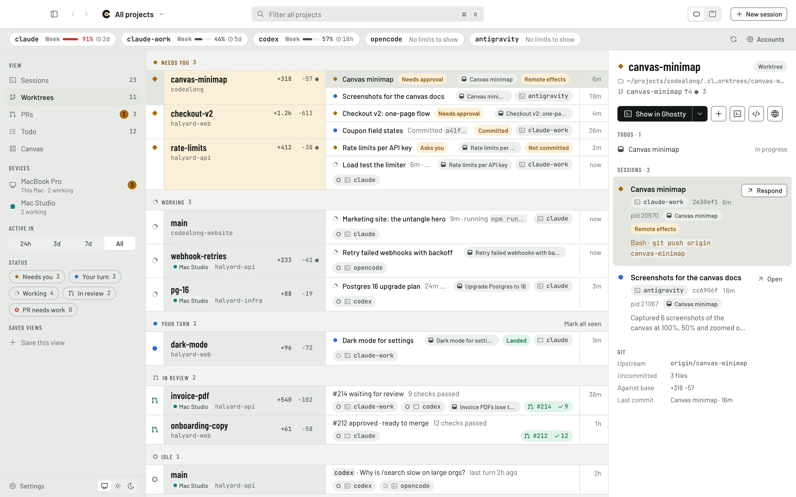
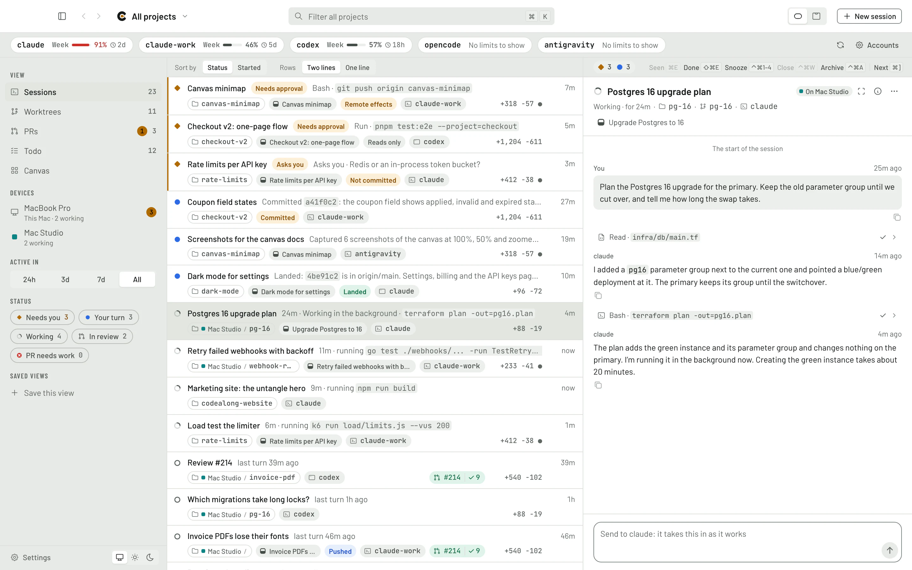
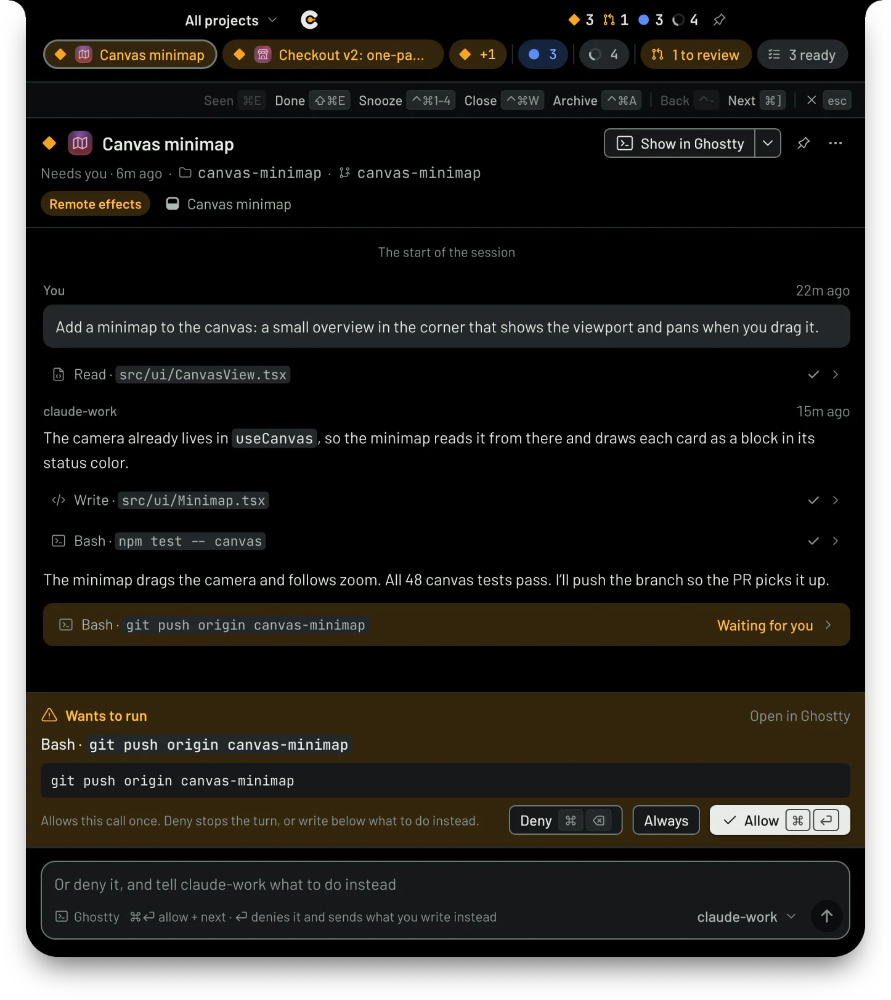
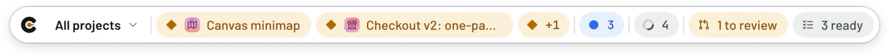
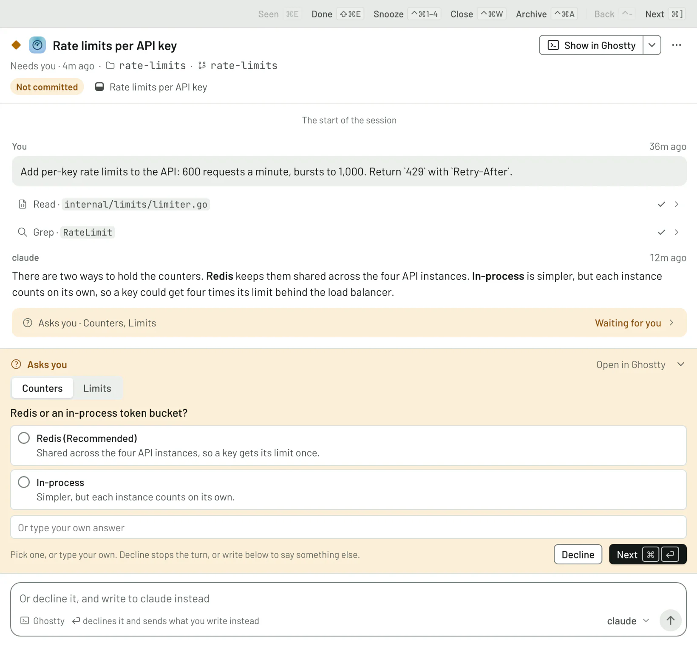
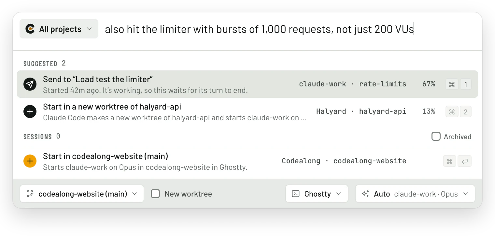
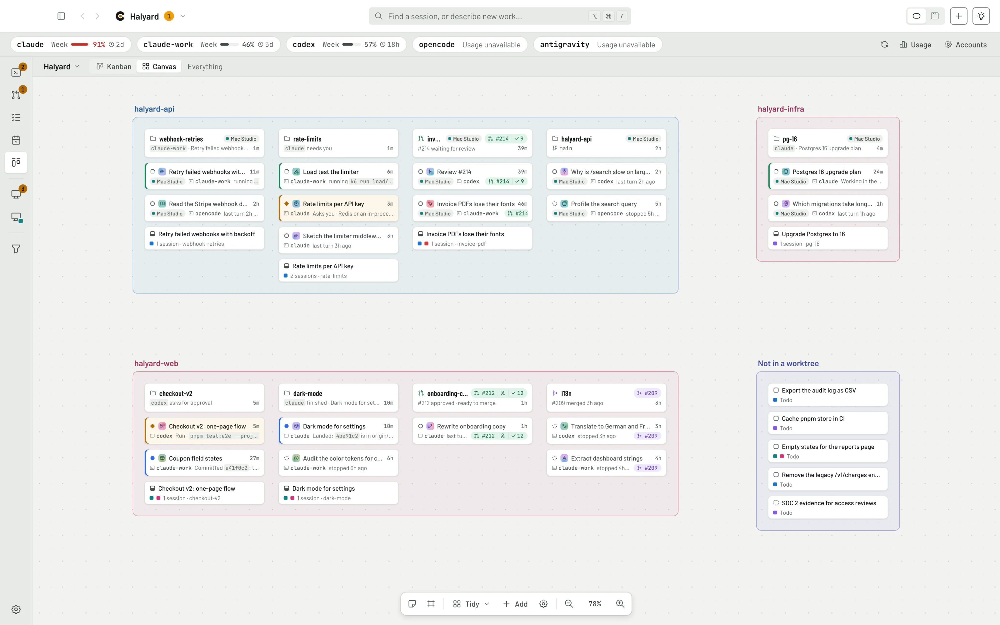

<p align="center">
  
</p>

<h1 align="center">Codealong</h1>

<p align="center"><strong>Every coding agent you run, in one window.</strong></p>

<p align="center">
  A free, open-source Mac app for people who run more than one coding agent at a time:<br />
  Claude Code, Codex, OpenCode, Antigravity and Cursor, on every account you have.
</p>

<p align="center">
  <a href="https://github.com/codealong/codealong/releases/latest"><strong>Download for macOS</strong></a>
  &nbsp;·&nbsp; <a href="#get-started">Get started</a>
  &nbsp;·&nbsp; <a href="#a-tour">Tour</a>
  &nbsp;·&nbsp; <a href="#what-works-with-each-agent">Supported agents</a>
  &nbsp;·&nbsp; <a href="#faq">FAQ</a>
  &nbsp;·&nbsp; <a href="docs/guide.md">Full guide</a>
</p>

<p align="center">
  <picture>
    <source media="(prefers-color-scheme: dark)" srcset="docs/images/board-dark.webp" />
    
  </picture>
</p>

## What it is

Running coding agents in parallel gets messy fast: a dozen terminal tabs, the Claude and Codex
apps, two or three accounts, and no way to tell which agent is waiting on you without clicking
through all of them.

Codealong finds every agent session on your Mac, wherever it started, and puts them all on one
board, organized the way your work is: **project → repo → worktree → branch → pull request**. It
shows what each agent is doing, brings the ones that need you to the front, lets you answer them
without switching apps, and opens any session right where it lives.

Your agents keep running exactly as their makers ship them. Codealong reads the records each one
already writes. It doesn't wrap, proxy or replace anything, and it needs no account, no API key
and no server.

- **See everything at once.** Every session from every agent and account, sorted into *Needs
  you*, *Your turn*, *Working*, *In review* and *Idle*. Questions, approvals, stuck agents and
  errors stand out.
- **Answer without switching apps.** Allow a command, answer a question or send a reply from a
  floating bar, your MacBook's notch, a session pinned to your desktop, or a *Waiting on you*
  window that walks you through everything, one agent at a time.
- **Start work in the right place.** Press ⌥⌘/ in any app, say what you want, and start it in the
  right worktree on the account with room, or send it to the agent that's already on it.
- **Read any conversation.** The whole transcript of any session, with its tool calls, images and
  links, searchable, and a box to reply.
- **Pull requests and todos beside the agents doing them.** Every PR is joined to the worktree
  and sessions behind it; review, approve and merge in place. Keep a todo list your agents can
  read and work through.
- **Know where your plan limits stand.** 5-hour and weekly limits for every account, always in
  view, and new work goes to the account with room.
- **All your Macs on one board.** Link your Macs and see, and if you allow it act on, the sessions
  running on any of them. An [iPhone app](https://github.com/codealong/codealong-ios) is on the way.

## Get started

### Install

1. Download `Codealong.dmg` from the [latest release](https://github.com/codealong/codealong/releases/latest).
2. Open it and drag Codealong into Applications.
3. Open Codealong.

It runs on Apple silicon and Intel Macs, is signed and notarized by Apple, and keeps itself up to
date: when a new version is ready, *Restart to update* shows at the foot of the sidebar. Prefer to
build it yourself? See [Building from source](#building-from-source).

**You'll need:**

- macOS 13 or later
- At least one coding agent: [Claude Code](https://code.claude.com/docs), the
  [Codex](https://openai.com/codex/) CLI or app, [OpenCode](https://opencode.ai),
  [Antigravity](https://antigravity.google) or [Cursor](https://cursor.com)
- A terminal: [Ghostty](https://ghostty.org) 1.3 or later (the best supported), iTerm2 or Terminal
- For pull requests, the [GitHub CLI](https://cli.github.com) signed in: `gh auth login`

### Your first five minutes

1. **Open Codealong.** It finds your agents' accounts by the files they keep: Claude Code's
   `~/.claude` and any sibling folders like `~/.claude-work`, Codex's `~/.codex`, OpenCode,
   Antigravity and Cursor, including accounts your shell's aliases point at. It looks for git
   repos in `~/projects`. Your sessions show up straight away, wherever you started them.
2. **Tell it where your code lives**, if that isn't `~/projects`: Settings (⌘,) › General. Group
   your repos into projects under Settings › Projects.
3. **Check your accounts** in Settings › Accounts. Accounts Codealong found but didn't add wait
   under *Found on this Mac*; add one with a click. Star the ones you'd like new work to go to
   first.
4. **Install the agent tools** from Settings › Agents. This puts the `codealong` command on your
   PATH, adds Codealong's plugin to each Claude Code account (so you can answer its permission
   prompts and questions from Codealong), and gives every agent a skill that tells it how to use
   the board.
5. **Say yes to macOS.** The first time Codealong opens or focuses a terminal tab, macOS asks
   whether it may control Ghostty, iTerm2 or Terminal. Allow it, so Codealong can bring the right
   tab forward and type your replies into it.
6. **Keep working the way you do.** Start agents in your terminal or their apps as usual. When
   you want something done, press **⌥⌘/** from any app. When agents are waiting on you, press
   **⌥⌘.** to work through them.

## A tour

### The board

<p align="center">
  <picture>
    <source media="(prefers-color-scheme: dark)" srcset="docs/images/macs-dark.webp" />
    
  </picture>
</p>

Five views of your work, each in a window of its own if you like (⌘⇧N):

| View | What it shows |
| --- | --- |
| **Sessions** | Every agent session in one list, the ones that need you first. Pin the ones you're watching. |
| **Worktrees** | Each worktree once: its branch, its PR, how far it is from main, and the agents working in it. |
| **PRs** | Every pull request in your repos, with its review, checks and the sessions that worked on it. Reviews asked of you come first. |
| **Todo** | Work you mean to hand an agent, with notes, screenshots, labels and what each todo waits on. |
| **Canvas** | Your work laid out in space: a frame per repo, a column per worktree, cards you arrange. |

Select anything to see it in the panel on the right; right-click anything for its menu. The
sidebar narrows every view to the Macs, time span and statuses you pick, and saved views bring
a setup back. Plan usage for every account runs across the top.

Every session and worktree has a status:

| Status | What it means |
| --- | --- |
| **Needs you** | The agent asked you something, wants to run something, hit an error, or has been busy and silent for 30 minutes (stuck). |
| **Your turn** | It finished a turn you haven't looked at yet. |
| **Working** | It's mid-turn, or a command it left running is still doing something. |
| **In review** | The worktree's pull request is open. |
| **Idle** | Nothing new. |

The Codealong mark shows the most urgent of them all at a glance: red for an error, amber when
you're needed (a review request too), blue for finished work you haven't seen, green while agents
work, and gray when all is quiet.

Across the top, each account's plan limits. Click one for the Usage window: what your sessions
used and what that would have cost at API prices, against what your plans and any extra usage
actually cost, day by day and by account, model, project and session. An account whose provider
may train its models on what you send (Help improve Claude, ChatGPT's Improve the model for
everyone, Cursor's Share Data, Antigravity's telemetry) has its chip in amber, and its card on hover
turns that off.

### Answer agents without switching apps

<p align="center">
  
</p>

When an agent wants to run a command, Codealong shows the call with **Allow**, **Always** and
**Deny**. When it asks you a question, you get its choices as buttons and a box for your own
answer. You can deny a call and say what to do instead in the same keystroke. The agent's own
prompt stays up too, and whichever you answer first counts.

You can answer from wherever suits you:

- **The floating bar** sits over every app, on every Space, even over full-screen apps, with
  pills for the agents that need you, have just finished or are working, one for PRs waiting on
  your review and one for todos ready to start. Hover a pill to read the conversation and reply.
  It never takes your keyboard until you click.
- **The notch.** Dock the bar into your MacBook's notch (an external display gets one drawn for
  it). Closed, it shows the most urgent count; click it and it opens on the agent that has waited
  longest.
- **Waiting on you** (⌥⌘. from any app) lists every agent that needs you, then the PRs waiting on
  your review, then finished turns, oldest first. Answer one and the next slides in: inbox zero,
  for agents.
- **Pinned to your desktop.** Keep a session floating over your other windows, or pin a session,
  worktree, todo or PR there as a small card.

A short sound tells you when an agent starts to need you or finishes its turn, so you hear it from
another app: not for the session you just answered, and one at most every few seconds. Pick the
sounds, or turn them off, in Settings › Sounds.

<p align="center">
  
</p>

The keys are the same everywhere: **⌘⏎** sends your reply (or allows the call) and moves on to the
next agent waiting, **⌘⌫** denies, **⌘E** marks a finished turn seen, **⌘]** skips, and
**⌃⌘1** to **⌃⌘4** snooze a session for 15 minutes, an hour, three hours or until tomorrow morning.

Approvals and questions can be answered for Claude Code (in a terminal, as a background job or in
the Claude app), OpenCode, Antigravity's command line in a terminal, and any agent you run inside
Codealong. Codex, Cursor and the Antigravity app show what they're waiting on, and open where they
ask.

<p align="center">
  <picture>
    <source media="(prefers-color-scheme: dark)" srcset="docs/images/waiting-dark.webp" />
    
  </picture>
</p>

### The quick panel: say what you want done

<p align="center">
  <picture>
    <source media="(prefers-color-scheme: dark)" srcset="docs/images/quick-dark.webp" />
    
  </picture>
</p>

Press **⌥⌘/** in any app. With nothing typed, it lists what needs you. Start typing and it finds
sessions (by title, branch or PR, or by what was said in them), todos and pull requests. Or keep
typing a prompt and start it, choosing:

- **the worktree** (⌘T), or tick *New worktree* for a fresh one;
- **the account, model and effort** (⌘L), or leave it on *Auto*;
- **where it runs** (⌘O): a terminal tab, in the background, the Claude or Codex app, or inside
  Codealong itself;
- and, with other Macs linked, **which Mac** (⌘D).

*Auto* picks the account with room: your starred accounts first while they have room (an account
at 90% of a limit has none), and of the rest, the one whose week resets soonest, so no week's
allowance goes unused, until it's at 85% and what's left is for the sessions already on it. A
question that isn't about any of your repos can go to a chat of its own. Type `/` to find your
repos' skills by name.

**Improve Codealong.** The button beside *New session*, or **⌥⌘,** in any app, opens the panel on
Codealong's own source with a picture of every Codealong window as it is: describe what to change,
and the session improves Codealong itself. With Codealong's source in none of your projects, the
panel offers to add one.

**Optional suggestions.** Turn on Jev (Settings › Jev, with your own [TypeSafe](https://typesafe.ai)
key) and the panel suggests where your prompt belongs: the agent already working on it, a free
worktree, a new chat, or a todo for later, each with how likely it is. It warns you when a running
agent may already be doing the same work, so two agents don't quietly race each other. Everything
else works without it.

### Every conversation, readable and answerable

Select a session to read its whole conversation, straight from the agent's own records: your
prompts, the replies as formatted text, and every tool call, which opens to show what went in and
what came out. Images you sent show in place, links to pull requests show their status, and
⌘F finds words anywhere in the conversation.

The box at the bottom replies the way that agent takes a prompt: typed into its terminal tab, sent
through Claude Code's background service, started as a new turn in the Codex app, or through
OpenCode's service. Paste screenshots or files into it. From there you can also:

- **stop** a turn (Esc or ⌘.), or **send now** to slip a message into the running turn (⌃⏎);
- **switch a running Claude Code session's model** without starting over;
- **ask on the side**: `/side <question>` asks a throwaway copy of a Claude Code or Codex session,
  which never hears of it;
- **fork** a session into a copy that carries on alongside (`/fork`);
- **copy** any code block, or **run** a shell block in a new terminal where the session works;
- **rename, pin, snooze, quiet, archive** or **mark as done** (which closes its terminal and
  archives it), or **move** a Claude Code session to another account or worktree.

Out of room mid-task? A Claude Code session stopped by its usage limit offers to move to an
account with room and carry on, or moves by itself if you let it. Lid closed and the network
dropped? Codealong tells the session to carry on once the connection is back. Terminal quit
partway through a turn? The session says it was cut off, and Carry on picks it up.

### Pull requests, with their agents

Every pull request in your repos is joined to the worktree and sessions behind it, including the
agent that opened it, pushed to it or commented on it. Colored pills show its review, checks and
conflicts, and rows that are your move are marked. Select one for its description, reviews,
checks, comments and diffs.

- **Review, approve and merge** without opening GitHub: merge commit, squash or rebase,
  auto-merge, the merge queue, updating the branch. A merge shows everywhere as you confirm it,
  and comes back with why if GitHub refuses it.
- **Snooze** a review request until later.
- **Nudge a PR's agent**, the session that opened it, and it's told when someone reviews, asks for
  changes or comments, or when checks fail, so it takes it from there; it's never told to merge.
- **Ask about a PR**: put questions to an agent that has read its whole diff.
- **Automatic reviews** (optional): an agent on the account and model you pick reviews each PR
  that asks for your review, told what to look for by instructions you can edit (which can have it
  start subagents of its own), and leaves a draft review on your account with its comments on the
  lines they're about, for you to finish and submit. The agent says whether it would approve or ask
  for changes, which the PR's box suggests, and it can approve for you when it finds nothing that
  needs fixing. The PR waits on you only once it's done, and new commits get reviewed again.
- **A second opinion on your agents' PRs** (optional): each PR a session of yours opens is
  reviewed by an agent on another model or provider (Codex reviews what Claude Code wrote, say),
  kept in Codealong and handed back to the session that opened it to act on. Nothing goes on
  GitHub.
- **Settings per repo, and shared with your team**: pick a repo in Settings › Automation to set how
  its PRs are reviewed and nudged. A `.codealong/config.toml` committed to the repo shares words
  for every review, which verdicts an agent may never submit, and what to suggest turning on, with
  everyone on the team; each person takes the suggestions or doesn't.

### Todos your agents can work

A todo list for work you mean to hand an agent, with notes, screenshots and files, labels, and the
todos each one waits on. Start a session from a todo (⌘N) and the two stay linked: the todo moves
to *In progress*, and the first session on it owns it, so a second agent started on the same todo
is told to send its findings to the first instead of redoing the work. Agents can read and update
the list themselves with the `codealong` command.

### The canvas

<p align="center">
  <picture>
    <source media="(prefers-color-scheme: dark)" srcset="docs/images/canvas-dark.webp" />
    
  </picture>
</p>

Your project laid out in space, to remember work by where it is. *Tidy* lays it out in a frame per
repo and a column per worktree, and new work comes in by itself beside what it belongs to. Add
notes and frames, pan and zoom as in Figma, and zoomed out, every card becomes a block in its
status color.

### Open anything where it lives

Double-click a session to bring forward its exact terminal tab in Ghostty, iTerm2 or Terminal,
its Claude app session or its Codex thread, or to resume it in a new terminal. Open a worktree in
your editor: VS Code, Cursor, Windsurf, Zed, Sublime Text, Nova, BBEdit, Xcode, the JetBrains IDEs
or Android Studio. ⌃` opens a terminal in the folder of whatever you're looking at. A worktree
whose dev server is running shows a green globe: click it to open the app, in the Chrome profile
you choose.

### All your Macs on one board

Turn on Settings › Devices on each Mac and link them once: on your
[Tailscale](https://tailscale.com) network both show the same six digits and you say yes;
anywhere else, you enter a link code. Each Mac then shows the others' worktrees and sessions
beside its own, with a badge saying which Mac each one is on. Read any conversation from any Mac.
Turn on remote control at a Mac, and your other Macs can send its sessions messages, answer their
approvals and start work there. Macs talk to each other directly, encrypted end to end, through
Tailscale or [iroh](https://iroh.computer); there's no Codealong server in between.

**On your iPhone**, [Codealong for iPhone](https://github.com/codealong/codealong-ios) links with
your Macs the same way and lists every session, most urgent first, to read, and where a Mac has
remote control on, to reply to, approve and start. It's early, and for now you build and install
it yourself.

### A board your agents can read too

The `codealong` command (installed from Settings › Agents) and its skill let your agents see what
other agents are doing in the same repo, pick up and finish todos, check which account has room,
message another session, or start one. It answers in JSON when an agent runs it, and in tables
in your terminal.

```bash
codealong whoami                     # which session am I, who else works here, my todos
codealong sessions find "rate limits"
codealong todo list --ready
codealong accounts --usage
codealong start --todo <id>
```

`codealong --help` lists everything, and so does
[the skill's reference](skills/codealong/references/reference.md).

An agent can also keep watch over all your sessions for you on a loop:
`codealong start --prompt "/codealong:orchestrate"` starts an orchestrator, which asks what you'd
like it to do, then tags what waits on you, suggests replies, and flags agents getting in each
other's way, without messaging any of them ([its skill](skills/codealong/references/orchestrate.md)).

## What works with each agent

Codealong reads what every agent already writes, so it sees all of them. What it can do from
there depends on what each one lets another program do. **Where it can't act, it opens the
session where it lives.**

| Agent | Sees it | Sends prompts | Answers approvals | Starts sessions | Several accounts | Usage limits |
| --- | :-: | --- | --- | --- | :-: | --- |
| **Claude Code** in a terminal | ✓ | Types into its tab | ✓ | ✓ | ✓ | 5-hour, weekly, per model |
| **Claude Code** background jobs | ✓ | Its background service | ✓ | ✓ | ✓ | 5-hour, weekly, per model |
| **Claude app** | ✓ | As a message from another session | ✓ (with the plugin) | Opens it with the prompt | Its signed-in account | Shared with Claude Code |
| **Codex CLI** | ✓ | Types into its tab | In its terminal | ✓ | ✓ | 5-hour, weekly |
| **Codex app** | ✓ | Starts a new turn | In the app | ✓ | Its signed-in account | 5-hour, weekly |
| **OpenCode** | ✓ | Its own service | ✓ | ✓ | — | You bring the provider |
| **Antigravity** | ✓ | Opens it, prompt on the clipboard | In the app | In its own window | — | Shown in the app |
| **Cursor** (new) | ✓ | `cursor-agent` in a terminal; app chats open with the prompt on the clipboard | In Cursor | `cursor-agent` | — | Monthly, Cursor's models and the others |
| **In Codealong** (Claude Code, Codex or OpenCode) | ✓ | ✓ | ✓ | ✓ | ✓ | Per account |

Terminals: Ghostty (the exact tab, keypresses, new tabs beside their worktree), iTerm2 and tmux
(typing and keypresses), and Terminal (typing). Approvals for Claude Code go through Codealong's
plugin, which Settings › Agents installs into each account. *In Codealong* means the agent runs in
Codealong's own panel, over the [Agent Client Protocol](https://agentclientprotocol.com).

## Keyboard shortcuts

From any app (change them in Settings › General):

| Keys | What they do |
| --- | --- |
| ⌥⌘/ | The quick panel: find anything, start a session |
| ⌥⌘' | The quick panel set to start a chat of its own, in no project |
| ⌥⌘. | Work through what waits on you, in the notch or the *Waiting on you* window |
| ⌥⌘, | Improve Codealong: the quick panel on Codealong's own project, with pictures of its windows |
| ⌥⌘; | Codealong's window, the one you were in last; pressed there, it hides Codealong |

In Codealong:

| Keys | What they do |
| --- | --- |
| ⇧⌘S · ⇧⌘W · ⇧⌘P · ⇧⌘T · ⇧⌘B | Sessions, Worktrees, PRs, Todo, Canvas |
| ⌘P | Switch project (⌥⌘1 – ⌥⌘9 jump to one, ⌥⌘0 shows them all) |
| ⌘K | The quick panel, in this window's project |
| ⌘N / ⌘⇧N | New session / new window |
| ⌘⏎ | Send your reply (or allow the call) and go on to the next agent waiting |
| ⌘⌫ | Deny the call |
| ⌃⏎ | Send now, into the running turn |
| ⌘1 – ⌘6 | Send a suggested reply, from the reply box (from anywhere in the notch and the waiting window) |
| Esc or ⌘. | Stop the turn |
| ⌘E / ⇧⌘E | Mark seen / mark as done |
| ⌘] / ⌘[ | Next / previous of what waits on you |
| ⌃⌘1 – ⌃⌘4 | Snooze: 15 minutes, 1 hour, 3 hours, tomorrow morning |
| ⌃⌘P · ⌃⌘A · ⌃⌘R · ⌃⌘U | Pin, archive, rename, mark as unread |
| ⌃⌘W | Close the session's terminal (the conversation stays, to resume) |
| ⌘F | Find where you are: in a session's conversation, a PR's files, or the list's filter |
| ⌥⌘F | The filter at the top, from anywhere |
| ⌃- / ⌃⇧- | Back / forward through the sessions you looked at |
| ⌃` | A new terminal in the folder of what's shown |
| ⌘C / ⌥⌘C | Copy the selected worktree's branch / path |
| ⇧⌘F | Expand the session panel (in Sessions) or the PR panel (in PRs) to the whole window |
| ⌃⌘S | Fold the sidebar |
| ⌘= · ⌘- · ⌘0 | Zoom in, out, actual size |
| ⇧⌘U | Usage: what sessions used and cost, at API prices and paid |
| ⌘, | Settings |

In the quick panel: **⏎** does the selected row, **⌘⏎** always starts a session, **⌥⏎** opens a
session where it lives, **⇥** answers a session in the *Waiting on you* window, **⌘1** – **⌘9**
pick a row, and **⌘T**, **⌘L**, **⌘O**, **⌘D** choose the worktree, agent, place and Mac. Right-click
menus show every action's keys.

## Settings

Everything is in Settings (⌘,), as a form and as the text of
`~/Library/Application Support/Codealong/config.toml`. Codealong writes that file on first run
from what it finds on your Mac, and watches it, so you can edit either. The form saves each change
in its place, keeping your comments and order, and `codealong config check` checks a file you
edited by hand.

A repo can share settings with everyone who works on it in `.codealong/config.toml`, read from the
branch its pull requests merge into (so a change goes for the team once it's merged), and
`codealong config check --repo <folder>` checks one before you push it:

```toml
[reviews]
instructions_file = "review.md"  # .codealong/review.md, added after each person's own instructions; or `instructions = "…"`
never_submit = ["approve"]       # verdicts never submitted as anyone's review, whatever their `submit` says
auto = true                      # suggested: each person takes it in Settings or a PR's Reviews tab, or doesn't
post = "comment"                 # suggested

[reviews.own]
instructions = "Check the tests cover what changed."
auto = true                      # suggested
send = true                      # suggested

[pull_requests]
nudge_about = "feedback-and-checks"  # for everyone
nudge_by_default = true          # suggested
```

Accounts, models, a person's own prompt and what's submitted as them stay each person's: a file
that sets one goes unused, with a notice saying why.

<details>
<summary>An annotated <code>config.toml</code></summary>

```toml
scan = ["~/projects"]          # where repos are found, three levels deep

[apps]
terminal = "ghostty"           # or "iterm2", "terminal"
editor = "cursor"              # or "vscode", "zed", "xcode"… (Settings lists those installed), or an app's name
new_terminal = "project"       # a tab beside the same worktree, repo or project; or "tab", "window"
move_pointer = false           # move the pointer to a terminal brought forward on another screen

[appearance]
theme = "system"               # follows macOS; or "light", "dark"
zoom = 110                     # the windows and the cards in the notch and peek, in percent, 50 to 200 (⌘= ⌘- ⌘0); absent at actual size

[shortcuts]
quick_panel = "Option+Cmd+/"        # works in every app; "" turns it off (Settings › General)
chat = "Option+Cmd+'"               # the quick panel set to start a chat of its own, in no project
waiting = "Option+Cmd+."            # the first session that waits on you: the notch, or the waiting window
improve = "Option+Cmd+,"            # the quick panel to improve Codealong itself, with pictures of its windows
main_window = "Option+Cmd+;"        # Codealong's window you were in last; pressed there, hides Codealong

[jev]                          # TypeSafe's Jev, each feature off until turned on (Settings › Jev)
model = "jev-latest"           # TypeSafe's newest stable release; jev-preview its newest, or a version (jev-1.14.0)
quick_panel = false            # suggestions as you type in the quick panel
sessions = false               # how each turn ended: asks you, stuck, landed, finished, risk
todos = false                  # links sessions to todos, done hints, new todos' labels
pull_requests = false          # review comments that ask for a change
emblems = false                # an icon beside each session's title, for what it works on

[search]
days = 14                      # prompts and replies searched this far back; 0 is titles only (Settings › General)

[devices]                      # your other devices (Settings › Devices)
enabled = false
tailscale = true               # find them on your tailnet
iroh = true                    # reach linked devices anywhere
remote_control = false         # let linked devices act on sessions here

[limits]
when_hit = "suggest"           # a session stopped at its usage limit offers a move; "move" moves it (Settings › Automation)

[sessions]
continue_after_network_error = true  # tell a session a lost connection stopped to carry on once it's back (Settings › Automation)
resume_for_sessions_it_started = true  # resume a session that isn't running, out of sight, when one it started sends it a message (Settings › Automation)

[reviews]
auto = false                   # an agent reviews each PR that waits on your review, and again on new commits (Settings › Automation)
account = ""                   # the account it runs on; "" for the one Auto would start
model = ""                     # the model it starts on; "" for the account's own
prompt = ""                    # what it's told to do (what to look for, subagents to start); "" for Codealong's own
start = "no-terminal"          # where its session runs, yours too: "no-terminal" (Claude Code's background service, else Codealong); "codealong"; "background" (a terminal behind your windows where the account has neither); "terminal" (in front, as new_terminal says)
post = "draft"                 # "draft": a draft review of yours to finish; "comment": a comment; "none": stays in the session
submit = "never"               # submit the agent's verdict as your review once posted: "approve", "approve-or-request-changes", "approve-or-comment"; "request-changes" or "comment" never approve

[reviews.own]
auto = false                   # an agent reviews each PR a session of yours opened here, and again on new commits (Settings › Automation)
account = ""                   # the account it runs on; "" for Auto's among those of another harness than the PR's session
model = ""                     # the model it starts on; "" for the account's own
prompt = ""                    # what it's told to do; "" for Codealong's own
send = true                    # hand each review to the session that opened the PR; nothing goes on GitHub
drafts = false                 # review your draft PRs too; others' drafts are never reviewed

[pull_requests]
nudge_by_default = false       # every open PR of yours tells the session that opened it what happens on it (Settings › Automation)
nudge_about = "everything"     # what a nudge tells of: "feedback" only comments and changes asked for; "feedback-and-checks" adds failing checks and conflicts

[sounds]                       # a short sound when something starts to wait on you (Settings › Sounds)
needs_you = "Pop"              # a session asks you something, waits on a call to allow, or stops with an error
your_turn = "Tink"             # a session's turn ended
review_requested = ""          # a PR asks for your review; "" is no sound
volume = 60                    # in percent of the Mac's own; any sound in /System/Library/Sounds or ~/Library/Sounds

[repos."github.com/acme/web".reviews]  # yours for one repo, over the above and its team's file (Settings › Automation, the repo picked)
account = "claude-work"        # any of [reviews], [reviews.own] (as reviews.own) and [pull_requests]; what's left out is as they say
post = "none"

[updates]
check = true                   # look for a new version by itself (Settings › General)

[debug]
perf_log = false               # true logs timings to ~/Library/Logs/Codealong/perf.log (Settings › Advanced)

[prices."some-new-model"]      # API prices for a model Codealong has none for yet, dollars per million tokens (the Usage window)
input = 3
output = 15

[[accounts]]
name = "claude-work"           # what the board shows
harness = "claude"             # claude, codex, opencode, antigravity or cursor
home = "~/.claude-work"
command = "claude-work"        # used for `claude-work --resume <id>`
start = "background"           # where new sessions start: terminal, background, claude-app (~/.claude only), codex-app (~/.codex only), codealong; a start from the quick panel sets it
# acp = "my-adapter --stdio"   # the Agent Client Protocol adapter Codealong runs its sessions through, in place of the installed one
preferred = true               # Auto starts it over accounts without this while it has room
monthly = 200                  # what its plan costs you a month, in dollars: Paid in the Usage window
# per_token = true             # it pays by the token (an API key): what its work cost at API prices was paid
# disabled = true              # turned off: Codealong starts nothing on it and leaves it out of the usage bar; its sessions still show

[[accounts]]
name = "opencode"
harness = "opencode"
home = "~/.local/share/opencode"  # OpenCode's data folder, with opencode.db
command = "opencode"           # used for `opencode --session <id>`

[[accounts]]
name = "antigravity"
harness = "antigravity"
home = "~/.gemini/antigravity" # the app's data folder; its command line's, ~/.gemini/antigravity-cli, is read with it

[[accounts]]
name = "cursor"
harness = "cursor"
home = "~/.cursor"             # the command line's folder; the Cursor app's chats are read with this one

[[projects]]
name = "Acme"
repos = ["github.com/acme/*"]
folders = []
chrome_profile = "Work"        # its worktrees' previews, and links into them, open in this Chrome profile; without it, the default browser
```

</details>

Codealong finds each agent by the files it keeps: Claude Code's `~/.claude` and sibling folders,
`~/.codex`, OpenCode's and Antigravity's databases, Cursor's `~/.cursor`, and the folders your
shell's wrappers and aliases point `CLAUDE_CONFIG_DIR`, `CODEX_HOME` or `XDG_DATA_HOME` at, which
also name the account and start it. The ones in use or signed in go into config.toml; the rest wait
under Settings › Accounts › *Found on this Mac*. What else Codealong keeps beside config.toml is
listed in the guide's [Files Codealong keeps](docs/guide.md#files-codealong-keeps).

## Privacy and safety

- **Nothing leaves your Mac unless you turn it on.** Transcripts stay on the Mac that ran them,
  and Codealong keeps only titles, statuses and short excerpts in memory. There's no sign-up and
  no Codealong server. GitHub is read through your own `gh` sign-in.
- **Jev is opt-in.** Each Jev feature is off until you add your own TypeSafe key and switch it on,
  and Settings › Jev says what each one sends (what you type, and your sessions' titles, branches
  and latest lines). The key stays in your login keychain.
- **Linked devices talk directly**, encrypted end to end, and read a conversation or search what
  was said only by asking the Mac it's on. Remote control is off until you turn it on at that Mac;
  then your linked devices can send prompts, answer approvals, start sessions and end them there,
  and each request is written to `~/Library/Logs/Codealong/devices.log`.
- **Git is read-only, but for cleaning up.** Codealong never commits, checks out, fetches or
  resets, and never creates a worktree: when you ask for a new worktree, Claude Code makes it. It
  removes one only when you clean it up (Clean up worktree…, or Mark as done on a background job
  that made its own) and nothing in it would be lost: no uncommitted file, no commit that isn't on
  a remote, nothing running in it. A repo whose worktrees a hook makes has them taken down by its
  own `WorktreeRemove` hook. Git runs with `GIT_OPTIONAL_LOCKS=0`, so it never holds a lock your
  agents need. A pull request is merged only when you press Merge.
- **Only you allow what an agent does.** Agents can see what another agent is waiting on, and deny
  it, but never allow it. With Codealong closed, your agents ask you the usual way.
- **It acts only when you ask.** Codealong types into a session only what you send it. Mark as
  done and Close idle sessions end only the sessions you pick, and their conversations stay, to
  resume.
- **Sessions you start** open in a new terminal running the account's own command, with your
  prompt passed in the window's environment (`CODEALONG_PROMPT`), so nothing in it is typed or
  needs quoting. A session run *In Codealong* is a child of the app, allowed what the agent's own
  permission settings allow, and asks only you; it ends when Codealong quits.

macOS will ask you about two things. The first time Codealong opens or focuses a terminal tab, it
asks whether Codealong may control Ghostty, iTerm2 or Terminal (Automation); without that,
Codealong can still open plain Ghostty windows. And a repo in Documents, Desktop or Downloads, or
on a removable drive, makes macOS ask whether Codealong may open that folder, again after each
update. Until you answer, those worktrees show without git, and after ten seconds or so the board
names the folders it's waiting on.

## FAQ

**Is Codealong really free?**
Yes. It's free and open source under the Apache License 2.0, with no account, no trial and no paid
tier. You pay only for what you already pay for: your agents' subscriptions, and a TypeSafe key if
you turn on Jev.

**Do I have to start my agents from Codealong?**
No. Codealong finds every session on your Mac, wherever it started: your terminal tabs, Claude
Code's background jobs, the Claude and Codex apps. Keep starting agents the way you do now, and use
the quick panel when it's quicker.

**Does it wrap or proxy my agents?**
No. Codealong reads the files each agent already writes, and starts new work in the official tool,
in your terminal or the maker's own app. Nothing sits between your agent and its model, and no API
keys are involved. The optional plugin adds one hook to Claude Code so you can answer its
permission prompts from Codealong. If you choose to run an agent inside Codealong instead, it talks
to the agent over the Agent Client Protocol.

**Can I use several Claude Code accounts?**
Yes. Each account runs the official Claude Code with its own config folder (`CLAUDE_CONFIG_DIR`),
and Codealong finds them on its own, even from an alias in your shell. Follow each provider's terms
for how you use your accounts.

**Does it change my git repos?**
Only to remove a worktree you clean up, and only when nothing in it would be lost: no uncommitted
file and no commit that isn't on a remote. Otherwise it runs git read-only. When work needs a new
worktree, Claude Code makes it, and a pull request is merged only when you press Merge.

**Which Macs, terminals and editors does it support?**
macOS 13 or later, on Apple silicon or Intel. Ghostty is the best supported terminal; iTerm2,
Terminal and tmux work too. It opens worktrees in VS Code, Cursor, Windsurf, Zed, Sublime Text,
Nova, BBEdit, Xcode, the JetBrains IDEs and Android Studio, or any editor you name.

**Can I answer my agents from my phone?**
Soon: [Codealong for iPhone](https://github.com/codealong/codealong-ios) is early, and for now you
build and install it yourself. Today you can answer an agent from any of your Macs: link them, and
turn on remote control on the Mac the agent runs on.

**How is it different from apps that run agents in their own window?**
Those apps see only the agents they launched. Codealong reads the agents you already run, across
harnesses, accounts and Macs, and sends new work to the right one.

### If something's missing

- **An agent's sessions don't show.** Look under Settings › Accounts › *Found on this Mac*, or add
  the account there by hand.
- **A repo's worktrees don't show.** Add the folder it's in to Settings › General (Codealong looks
  three levels deep). Sessions outside your folders are listed under *Elsewhere*.
- **No pull requests.** Sign in to the GitHub CLI with `gh auth login`. A chip at the end of the
  accounts bar says when GitHub is signed out or out of requests.
- **Codealong can't bring a terminal tab forward or type into it.** Allow it under System
  Settings › Privacy & Security › Automation.
- **Ghostty answers only once you bring it forward.** macOS naps it while it's behind other
  windows. Run `defaults write com.mitchellh.ghostty NSAppSleepDisabled -bool YES`, then quit and
  reopen Ghostty.
- **Something stopped working in the background.** Codealong says so in a chip at the end of the
  accounts bar; click it for what happened and what to open to fix it.

## Building from source

```bash
git clone https://github.com/codealong/codealong.git
cd codealong
npm install
npm run tauri dev
```

You'll need Rust (`rustup`), Node 20 or later and Xcode's command line tools.
[docs/development.md](docs/development.md) has the rest: building an app bundle, running the tests
and the UI checks, and a map of the code. [CLAUDE.md](CLAUDE.md) has the notes every change follows.

## Learn more

- **[The guide](docs/guide.md)**: every feature in detail, view by view and window by window.
- **[Developing Codealong](docs/development.md)**: building, testing and the code map.
- **[Codealong for iPhone](https://github.com/codealong/codealong-ios)**: your sessions on your
  phone.
- **[The design system](https://claude.ai/artifact/Eg7p4HkWgTVUR54RfYgUPc)**: tokens, components,
  the model and the build plan (the app has moved past it in places).

## License

Copyright 2026 Gordon L. Hempton. The code is under the [Apache License 2.0](LICENSE); copies
carry the [NOTICE](NOTICE). The Codealong name and logo are trademarks, and the license doesn't
grant rights to them: a fork should go by its own name.
