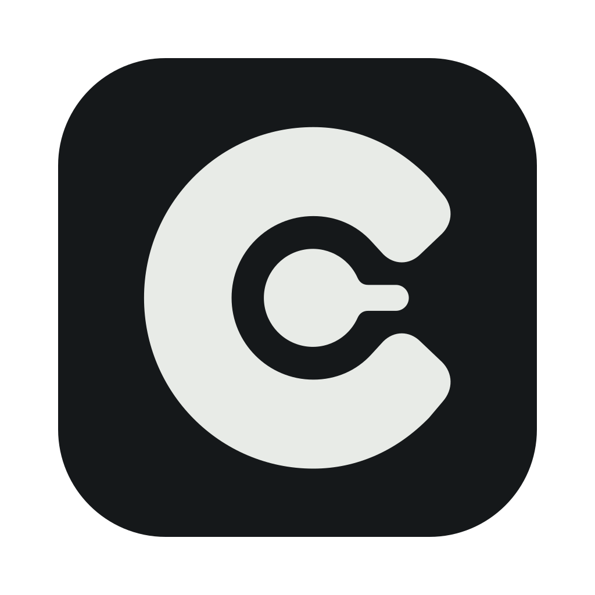

# Codealong



A Mac app that keeps track of every coding agent you have running: Claude Code on two
accounts (`claude`, `claude2`), the Codex app, OpenCode and Antigravity. It sorts them by
project, worktree, branch and PR, shows what each one is doing, and opens any session where
it lives: Ghostty for terminal sessions, the Claude app, Codex, Antigravity, or Cursor for
the folder.

**Every agent runs in a worktree, and every worktree is a lane.**

The design lives in the Codealong design system (tokens, components, and the model,
surfaces, harness adapters, apps, architecture and build plan pages):
https://claude.ai/artifact/Eg7p4HkWgTVUR54RfYgUPc

## What it does

- **Four views** of the current project, each in a window of its own if you like (⌘⇧N):
  - **Worktrees**: each worktree once, pinned ones first in your order, then the rest by
    status: Needs you, Working, Your turn, In review, Idle, Merged. A worktree's row has a
    line for each agent that needs you, is working or just finished, which you select, open
    or right-click as you would a row. An agent is listed under the worktree it's working
    in, where most of its latest commands ran and edits landed, even if it started somewhere
    else; resuming it still happens where it started. Within a status, the worktree and the
    agent you last sent a prompt come first, so rows hold still while agents work. Stuck
    agents (busy but silent for 30 minutes) show in Needs you with the command they're stuck
    on. The Inbox filters narrow each worktree to the agents they're about. Pin a worktree
    with `p` or the right-click menu of the worktree or one of its agents, and reorder pins
    by dragging or with ⌥↑ ⌥↓; a pinned worktree stays whatever the age filter says.
  - **Sessions**: every session, pinned ones first in your order (drag or ⌥↑ ⌥↓), then by
    day, most urgent first and then the one you last sent a prompt. Sessions are pinned
    here, with `p` or the right-click menu, and their pins show only here. Archive a session
    with `a` or its right-click menu; Codex threads are archived in Codex itself.
  - **PRs**: every PR in the project's repos, with the worktree and sessions that worked on
    each. Reviews asked of you come first, with one-click Approve. Colored pills say where
    each PR stands: its review, its checks, and conflicts or an out-of-date branch, or one
    green Ready to merge when GitHub would merge it now. Rows that are your move are marked
    at the left edge: amber for a review asked of you or something to fix, red for failing
    checks, green for your PRs that are ready to merge. Selecting a PR shows its
    description, reviews, checks, comments (with `[jev] pull_requests`, the ones asking the
    author for a change or an answer are marked and listed first) and changed files with their
    diffs, and under On this Mac
    the worktrees and sessions behind it, drawn like the sidebar's tree: whether the worktree
    has anything GitHub doesn't, and the agents that worked on the PR, including one that made
    the worktree from another folder.
  - **Todo**: work you mean to hand an agent. Each todo has a title, a description that can
    hold screenshots and any other files (paste, drop or attach them; files copied in the
    Finder paste too), colored labels, and a status: Todo, In
    progress (an agent is on it) or Done. The list has In progress, Ready, Waiting and Done.
    Add one in the box at the top (`n`), reorder by dragging or with ⌥↑ ⌥↓, mark one done
    with `x`. A todo can wait on other todos (Waits on, in its panel): until they're done it's
    under Waiting and shows what it's waiting on, and a dependency that would make a loop is
    refused. One an agent is already on stays In progress. Mark a todo as waiting by hand
    (`w`, the right-click menu, or type what it waits for in Waits on) when it waits on
    something outside the list, like a person's answer or a release; it stays there until
    you stop it waiting, start it or finish it. Stop waiting (`w` again) also drops what it
    waits on that isn't done, so it's Ready at once; the toast can undo it. Start session
    (⌘N) opens the quick panel with the todo as the prompt, and the session it starts
    is linked to the todo, which moves to In progress; one started in the Claude or Codex
    app is linked when it shows up.
    Link worktrees and sessions you already have from the todo, or from a session's or
    worktree's right-click menu (Add to todo). A session or worktree on a todo shows the
    todo's chip; click it to go to the todo.
    With Jev on for todos (Settings › Jev, `[jev] todos`), a session that starts outside a todo
    is linked to the open todo it's for when Jev is sure; a todo whose linked sessions ended
    their turns, or whose PR merged, shows Looks done when Jev reads it as finished (Mark done,
    or Not yet until something moves on); and a todo's panel suggests its project, labels and
    the todos it waits on as chips you click. Nothing is asked twice: what was asked is kept in
    `jev-todos.json`.
  - **Canvas**: the project's work laid out in space, to remember by where it is. Worktrees,
    sessions, todos and PRs are compact cards (status, title, where it stands); hover one for
    the rest, select one for its panel on the right (the one its own view shows), double-click to open it where it lives, right-click for its usual menu. Recent
    work comes on by itself: sessions active in the last day (24h, 3d, 7d or all, chosen in
    Tidy) and any that's working or needs you, open todos (changed or worked on in the last
    7 or 30 days, every open one, or none), and the worktrees they're in. A new one lands
    beside what it belongs to and nothing else moves; what you move or add stays, and what you
    take off doesn't come back by itself. Add older things from Add in the toolbar, a
    right-click on the canvas, or Add to canvas in any row's menu. Notes (`n`) and frames
    (`f`) organize it; a frame carries what's in it. Tidy lays the cards out in columns, one
    per worktree, in a frame per repo or per day, and takes off cards older than its ages,
    kept or not, which is how the sessions you never archived leave; its panel says what
    would come off and on first. Frames you drew or renamed stay, with what's in them. Clear
    canvas (in Tidy, or a right-click on the canvas) takes everything off; from then on a
    session comes back when it moves on (a new prompt, a finished turn, a question for you) and
    a todo when it changes, until Include older work in Tidy lifts that. Controls follow Figma: scroll or Space-drag to pan, pinch
    or ⌘-scroll to zoom, ⇧1 fit all, ⇧2 the selection, ⇧0 100%. Zoomed out, cards become
    blocks in their status color drawn by the GPU (WebGL2).
- **Open where it lives**: the session's own Ghostty tab, the Claude app session, the Codex
  thread, an OpenCode session in its terminal (or resumed in a new one with `--session`),
  Antigravity brought forward (it has no link to a conversation), a background job attached
  in a new terminal, or the folder in Cursor. A new terminal opens as a tab in the Ghostty
  window already showing that worktree, repo or project (`new_terminal` in config.toml).
- **Quick panel** (⌥⇧Space from any app, over full-screen ones too; ⌘N, the title bar, the
  inspector, or a worktree's or session's right-click menu in Codealong): one input, and below
  it what you can do next. With nothing typed it lists the sessions that need you, then the
<<<<<<< HEAD
  ones whose turn ended (the working ones when nothing waits on you), and under them the first
  three todos ready to start, in your order. Typed words find
  sessions by title, account, worktree, branch, repo, project or PR, and under them todos by
=======
  ones whose turn ended (the working ones when nothing waits on you). Typed words find
  sessions by title, account, worktree, branch, repo, project or PR, then by what was said in
  them (your prompts and the agents' replies, for sessions active in the last `[search] days`,
  with the matching line shown), and under them todos by
>>>>>>> origin/main
  title, description, label, project, or the worktrees and sessions linked to them. ⏎ on a todo
  opens its session, or, when it has none, gets a session ready to start for it (its prompt,
  its worktree, linked to it). The last row starts a new session with what you typed as its
  prompt. ⏎ does the selected row, ⌘⏎ always starts, ⌥⏎
  shows the session or todo in Codealong, ⌘1 to ⌘9 open a row, Escape closes. Each open starts empty,
  so ⏎ goes to what needs you; ↑ brings back what you'd typed before closing, then earlier prompts you sent, started or saved, and ↓ goes forward again. While you type, the list doesn't shrink until you pause and the answers are in, so the panel holds still. A project picker (⌘P) narrows everything to one project. The shortcut is
  yours to change in Settings › General; Settings names shortcuts macOS and common launchers
  already use.
- **Session status from Jev** (optional; Settings › Jev, `[jev] sessions`): once per turn,
  Jev reads the end of the last reply and the command a session runs or waits on. A reply
  that asks you something turns *Your turn* into *Needs you*, with the question; a busy session
  quiet on a long build stays *Working* instead of *stuck*; a command left running in the
  background says whether it polls for something or runs a job. Rows show how far the work
  got (Landed, Pushed, Committed, Not committed, Blocked) and how risky a command waiting for
  approval looks; a worktree whose sessions all read as done says *Looks finished*. Answers are
  kept in insights.json, so a turn is asked about once. Without Jev, a Claude session whose turn
  left a command running in the background (registry status `shell`) is always *Working*.
- **Suggestions in the quick panel** (optional; Settings › Jev, `[jev] quick_panel` in config.toml):
  once you pause typing, TypeSafe's Jev reads what you wrote against the project's sessions and
  worktrees and the panel leads with up to three suggestions, each with how likely it is: send
  it to a session that's already going, start new work in a worktree (a new one when it's a
  change of its own), open a session, or keep it as a todo. ⏎ does the first. The same call
  says whether a running session may already be doing it (start rows say so, and sending to it
  is offered), puts the sessions it thinks you mean first among the search results, and rates
  how big the change is: when Auto starts Claude Code in the terminal, a tiny change starts on
  Haiku and a small one on Sonnet, never bigger than Auto's own pick or on a model whose limit is
  nearly used. Sending goes the
  way each harness takes a prompt: pasted into the session's Ghostty tab, Claude Code's daemon
  for a background job, OpenCode's service, a turn started by the Codex app itself (else the
  thread opens with the prompt filled in), and Claude Code's cross-session socket for Claude
  app sessions, which read it as a message from another session. A session that isn't running
  is resumed with the prompt; one waiting on you is opened instead, so what you typed can't
  answer its question. The API key stays in the login keychain. What you type, repo names and
  session titles and latest lines go to TypeSafe.
- **New session**, the panel's last row: pick the worktree (⌘T; it starts at whatever's
  selected in Codealong: a worktree, a session's, a PR's, or for a PR with none here its repo's
  main checkout; pinned ones first), the account and model in one menu (⌘L, every account on
  every model it can start on, with its limits), and where it runs. Ghostty starts Claude Code
  on your prompt, on the account's default model or the one you picked (Fable, Opus, Sonnet,
  Haiku, 1M context, Opus Plan Mode), and with New worktree Claude Code makes a fresh worktree
  for it (`claude --worktree`: its folder, branch and base are Claude Code's choice). The
  Claude app and Codex open a new session with the prompt filled in, and you send it there
  (their own model and worktree choices included). OpenCode starts in Ghostty on your prompt
  (`--prompt`); Antigravity starts conversations only in its own window. Auto, the default,
  picks between accounts of one harness: first the one whose weekly limit resets soonest
  within 48 hours, so its room isn't lost, else the one with the most room, judged by the
  limits its default model spends; accounts at 90% of a limit are passed over. It starts on
  that default model, or the next best (Opus, then Sonnet) when the default's own weekly limit
  is nearly used up. Codealong only launches: the session shows on the board like any other,
  and one started in Ghostty is selected as soon as it appears. Paste or drop screenshots and
  other files into the prompt: Claude Code in Ghostty gets them as file mentions (attached
  when they're 256 KB or less, read otherwise, with their folders added so it doesn't ask),
  and the apps and OpenCode get their paths.
- **Usage** for every account in a bar across the top: 5-hour and weekly limits, per-model
  limits such as Fable, and time to reset. When they don't all fit, each account shows the
  limit it's closest to running out of and the rest on hover, and the bar scrolls sideways.
  OpenCode (bring your own provider) and Antigravity (quotas in the app) have none to show.
  Add accounts in Settings › Accounts.
- **Settings** (⌘,, the app menu, or the foot of the sidebar): a form for everything in
  config.toml. General has the folders searched for repos, the quick panel's shortcut, the
  terminal and editor, and the theme; Jev has the TypeSafe key (kept in the keychain) and a
  switch per feature, each saying what it sends; Accounts adds, edits, removes and signs in accounts, and under Found on this Mac lists
  the ones Codealong could read but doesn't, to add with a click (with the agent skill, unless
  you untick it); Projects groups repos by pattern;
  Advanced turns the performance log on and shows where the files are. Each change is saved in
  its place in the file, so comments and order stay as you wrote them. The config.toml section
  edits the file itself, for anything the form doesn't cover, and says what's wrong when it
  doesn't parse.
- **Filters**: the Inbox (Needs you, Working, Your turn, In review, Checks failing), search,
  and how recently things were active (24h, 3d, 7d, all).
- **Light or dark**: follows macOS unless you pick light or dark with the buttons at the foot
  of the sidebar. The choice is saved in config.toml, and every window follows it.
- **Resizable panels**: drag the inner edge of the sidebar or the panel on the right, and
  double-click it to go back to the default width. The PR panel keeps a width of its own.
- **Floating bar**: a small bar on top of every window, on every Space and over full-screen
  apps, with a pill for each agent that needs you, whose turn just ended, or that's running,
  one for PRs waiting on your review, and one for todos ready to start. The project button
  beside the mark shows one project or all of them; a badge on it counts what needs you in the
  others. Click a pill to open the session where it lives; right-click it to show it in
  Codealong or mark it seen. The todos pill opens the quick panel ready to start a session for
  a todo (its menu picks which). Pills that
  don't fit fold into one per group that lists them. The mark brings Codealong forward; drag
  the bar by it or by its gaps. The capsule button at the top right of the window turns it on
  and off, as do Window › Floating bar and the bar's own right-click menu.
- **New window** (File › New window, ⌘⇧N): one more window on the project you're looking at.
  Closing the main window hides it; New window, the Dock icon or the bar brings it back, and
  ⌘Q quits.

- **For agents**: the `codealong` command and a skill that tells an agent when to use it.
  `codealong whoami` says which session runs it and which todos are linked to it or its
  worktree; `codealong todo add|start|done|update|move|wait|ready|link` work the todo list,
  dependencies, waits and order included (`todo list --ready` is what can start now,
  `--waiting` what's under Waiting); `codealong
  sessions [find <words>]`, `session show`, `worktrees` and `accounts --usage` answer what else
  is running, what it did, where it lives, and which account has room; `codealong start
  --todo <id>` starts a session the way New session does; `codealong config show|check`
  prints the settings and checks an edited config.toml. With the app running, answers come
  from it over a socket and todo changes go through its engine; with it closed, the command
  reads the files (sessions then show without git or PRs). Output is JSON when piped, tables
  in a terminal. Settings › Agents installs the command (a symlink on PATH) and the skill
  into every account's skills folder (`~/.claude/skills`, `~/.claude2/skills`,
  `~/.codex/skills`, `~/.config/opencode/skills`, `~/.gemini/config/skills`), and keeps the
  copies current; `codealong install` does the same from a terminal. Claude Code users can
  instead add the repo as a plugin marketplace: `/plugin marketplace add codealong/codealong`,
  `/plugin install codealong@codealong`. See *For agents* below.

Next: the menu bar icon and popover, and notifications (the design system's *Build plan*).

## Requirements

- macOS 13 or later
- Rust (`rustup`), Node 20+
- `gh` signed in (`gh auth login`) for PRs
- Ghostty 1.3+ and Cursor (both swappable later through app profiles)

## Develop

```bash
npm install
npm run tauri dev      # the app with hot reload
scripts/relaunch.sh    # build the bundle, then quit and reopen the app
npm run snapshot       # print the board as a table without opening a window
```

Builds go to `../codealong-target`, one directory shared by every checkout and worktree
(`.cargo/config.toml`); `scripts/target-dir.sh` prints it. Tests: `npm test` (vitest),
`npm run typecheck`, and `cargo test` in `src-tauri`
(model rules, parsers, git and GitHub parsing, usage, config writes, deep links, Ghostty
scripts). `scripts/preview.sh` renders the UI in headless Chrome against your real data with
Tauri's IPC stubbed. CLAUDE.md has the rest of the working notes.

The [logo master and brand notes](design/brand/README.md) live in `design/brand`.
Run `npm run icons` to regenerate the UI mark, browser icon and native bundle icons.
The mark's inner node shows the app-wide status: red for session errors, amber when
you are needed (including PR review requests), blue for unread results, green while
agents work, and light gray when idle, in that priority order. The project switcher,
floating bar, browser icon and running Dock icon stay in sync across projects.

## Settings

`~/Library/Application Support/Codealong/config.toml`, written on first run from what
Codealong finds and watched for changes. It finds each harness by the files it keeps: Claude
Code's `~/.claude` and sibling folders like `~/.claude2`, `~/.codex`, OpenCode's and
Antigravity's databases, and folders your shell's wrappers and aliases point
`CLAUDE_CONFIG_DIR`, `CODEX_HOME` or `XDG_DATA_HOME` at, which also name the account and start
it. The ones in use or signed in go into config.toml; the rest wait under Settings › Accounts ›
Found on this Mac. Settings (⌘,) edits it as a form, or as text:

```toml
scan = ["~/projects"]          # where repos are found, three levels deep

[apps]
terminal = "ghostty"
editor = "cursor"
new_terminal = "project"       # a tab beside the same worktree, repo or project; or "tab", "window"

[appearance]
theme = "system"               # follows macOS; or "light", "dark"

[shortcuts]
quick_panel = "Option+Shift+Space"  # works in every app; "" turns it off (Settings › General)

[jev]                          # TypeSafe's Jev, each feature off until turned on (Settings › Jev)
model = "jev-latest"
quick_panel = false            # suggestions as you type in the quick panel
sessions = false               # how each turn ended: asks you, stuck, landed, finished, risk
todos = false                  # links sessions to todos, done hints, new todos' labels
pull_requests = false          # review comments that ask for a change

[search]
days = 14                      # prompts and replies searched this far back; 0 is titles only (Settings › General)

[debug]
perf_log = false               # true logs timings to ~/Library/Logs/Codealong/perf.log (Settings › Advanced)

[[accounts]]
name = "claude2"               # what the board shows
harness = "claude"             # claude, codex, opencode or antigravity
home = "~/.claude2"
command = "claude2"            # used for `claude2 --resume <id>`

[[accounts]]
name = "opencode"
harness = "opencode"
home = "~/.local/share/opencode"  # OpenCode's data folder, with opencode.db
command = "opencode"           # used for `opencode --session <id>`

[[accounts]]
name = "antigravity"
harness = "antigravity"
home = "~/.gemini/antigravity" # its app data folder, with conversation_summaries.db

[[projects]]
name = "Northwind"
repos = ["github.com/northwindai/*"]
folders = []
```

What you've seen (for Your turn), what you've pinned and what you've archived in Codealong
are kept in `state.json` next to it; whether the floating bar is on, and where you left it, in
`bar.json`; each project's canvas in `canvas.json`. Todos and labels are in `todos.json`, which is watched, so an agent or an editor can
add to it. Attachments are kept by their content: images in `images/`, other files in
`files/<hash>/<name>`; ones no todo uses are cleared after 30 days.

## For agents

`skills/codealong/` is one skill in the Agent Skills layout (`SKILL.md` plus
`references/reference.md`, generated from `codealong --help` by `scripts/skill-reference.sh`),
read as-is by Claude Code, Codex, OpenCode and Antigravity. The app ships it in its bundle and
Settings › Agents (or `codealong install`, or adding an account in Settings) copies it into each
account's skills folder with a `.codealong-version` marker; at launch the app refreshes copies it
made when the skill changed, including ones in folders of accounts you've since removed, and
never touches a folder it didn't make. A copy someone edited is left alone: Settings › Agents
marks it Edited, and replaces it only when asked (so does `codealong install --account <name>`). `plugin/` wraps the same skill as a Claude Code plugin
(`.claude-plugin/plugin.json`, a `bin/codealong` shim that finds the app, and a `SessionStart`
hook that runs `codealong whoami --context`), and `.claude-plugin/marketplace.json` makes the
repo a marketplace.

The command talks to the running app over `codealong.sock` next to the config (JSON lines, one
request and reply per line, mode 0600), and the app answers with the board its windows have and
applies todo changes through its engine, so nothing writes over anything. Without the app, todo
changes go to `todos.json` under an advisory lock the app takes too, and sessions come from a
light scan (no git, PRs or visitors).

## Permissions and safety

- The first time Codealong opens or focuses a terminal session, macOS asks whether it may
  control Ghostty (Automation). Without it, Codealong can still open plain Ghostty windows.
- Codealong only reads: it never creates, resets or removes worktrees, never changes
  branches, and never types into a live session. Git runs with `GIT_OPTIONAL_LOCKS=0`.
- Starting a session types the account's command into a new Ghostty window; the prompt goes in
  the window's environment (`CODEALONG_PROMPT`), so nothing in it is typed or needs quoting.
- Transcripts stay on the Mac; only titles, statuses and short excerpts are kept in memory.

## Code

| Path | What |
| --- | --- |
| `src-tauri/src/engine.rs`, `throttle.rs` | Caches, file watching (FSEvents), git workers (spaced per worktree, results published in batches), GitHub, publishing the board |
| `src-tauri/src/board.rs` | The model's rules: status, bays, headlines, open targets (pure, tested) |
| `src-tauri/src/claude.rs`, `codex.rs` | Harness adapters: registries, transcripts, rollouts, incremental tailing |
| `src-tauri/src/opencode.rs`, `antigravity.rs` | Harness adapters: OpenCode's database and background service, Antigravity's conversation summaries |
| `src-tauri/src/repos.rs`, `git.rs`, `github.rs` | Repo discovery, callsigns, worktrees, git status, PRs |
| `src-tauri/src/launch.rs` | App profiles: Ghostty (AppleScript, exact tab focus), Cursor (CLI), deep links |
| `src-tauri/src/start.rs`, `src/start.ts` | New sessions: where each account can start one, the launch it makes, the agent menu (every account on every model) and Auto's pick |
| `src-tauri/src/quick.rs`, `src/quick.ts`, `src/ui/Quick.tsx` | The quick panel: its window (a panel that takes the keyboard over any app), its shortcut, and its page (what needs you, finding sessions, starting one) |
| `src-tauri/src/search.rs` | Searching what was said in sessions: an in-memory index of prompts and replies, read once per file and then from where it stopped |
| `src-tauri/src/route.rs`, `src/route.ts` | Suggestions in the quick panel: the request to Jev and reading its answer back, the key in the keychain, and which suggestions the panel shows |
| `src-tauri/src/todojev.rs` | Jev on todos: which todo a new session is for, whether a todo's work looks done, and a todo's suggested project, labels and dependencies |
| `src-tauri/src/send.rs` | Sending a prompt to a session that's already going, the way its harness takes one |
| `src-tauri/src/cli.rs`, `server.rs`, `install.rs` | The `codealong` command (clap; JSON or tables; the app over its socket, else the files), the app's socket, and putting the skill and the command where agents find them |
| `src-tauri/src/todos.rs`, `src/todos.ts` | Todos: the store and its changes, linking sessions started from a todo; the list's sections, filters and prompt |
| `src-tauri/src/canvas.rs`, `src/canvas/`, `src/ui/CanvasView.tsx`, `src/ui/CanvasCard.tsx` | The Canvas view: its documents (what's on it, where; kept in sync with the board; Tidy's layouts), the WebGL layer (grid, links, zoomed-out blocks) and the HTML cards, notes and frames on top |
| `src-tauri/src/attachments.rs`, `src/attachInput.ts` | Files in descriptions and prompts: pasted, dropped or picked, kept by content, images shown in place, all handed to agents as paths |
| `src-tauri/src/usage.rs` | Plan usage: Claude through its sign-in and usage endpoint, Codex from its rollouts, none for OpenCode and Antigravity |
| `src-tauri/src/appserver.rs` | Codex actions through its app-server (archiving) |
| `src-tauri/src/claudeapp.rs` | The Claude app's session records (its IDs, what you archived there) |
| `src-tauri/src/config.rs`, `state.rs` | `config.toml` (accounts saved in place) and `state.json` (seen, pinned, archived, account folders already read) |
| `src-tauri/src/detect.rs` | The harness accounts on this Mac: folders, sign-ins, and the wrappers and aliases that run them |
| `src-tauri/src/bar.rs`, `barfeed.rs` | The floating bar's window (a panel over every app, where it sits, Window › Floating bar) and the small feed of what it shows, sent only when that changes |
| `src/` | The React UI, built from the design system's components and tokens; `lanes.ts` groups the board and mirrors the engine's status rules for the age filter; `pins.ts` keeps the pinned lists; `prStatus.ts` and `ui/PrPills.tsx` say where a PR stands and which PRs are your move; `bar.ts` and `ui/Bar.tsx` lay out the floating bar; `ui/Picker.tsx` is the quick panel's filterable menus; `ui/SettingsDialog.tsx` and `ui/AccountsSection.tsx` are Settings |
| `scripts/preview.sh` | Headless preview against real data, for screenshots and scripted checks |
| `design/tokens.json` | Design tokens; `npm run tokens` regenerates `src/styles/tokens.css` |
