<p align="center">
  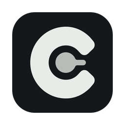
</p>

<h1 align="center">Codealong</h1>

<p align="center"><strong>Every coding agent you run, in one window.</strong></p>

<p align="center">
  Answer your agents from your MacBook's notch. Have an agent review every pull request,<br />
  on the plans you already pay for. Start work from any app, on the account with room.
</p>

<p align="center">
  It works beside the agents you already run: Claude Code, Codex, OpenCode, Antigravity and Cursor,<br />
  in your own terminal and in their desktop apps, on every account and machine you have.<br />
  Free and open source, for macOS and Linux.
</p>

<p align="center">
  <a href="https://www.codealong.com/download"></a>
</p>

<p align="center">
  or <code>brew install --cask codealong/tap/codealong</code>
</p>

<p align="center">
  <a href="https://github.com/codealong/codealong/releases/latest"></a>
  <a href="LICENSE"></a>
  <a href="#what-works-with-each-agent"></a>
  <a href="https://github.com/codealong/codealong/stargazers"></a>
</p>

<p align="center">
  <a href="https://www.codealong.com"><strong>codealong.com</strong></a>
  &nbsp;·&nbsp; <a href="#get-started">Get started</a>
  &nbsp;·&nbsp; <a href="#a-tour">Tour</a>
  &nbsp;·&nbsp; <a href="#what-works-with-each-agent">Supported agents</a>
  &nbsp;·&nbsp; <a href="#faq">FAQ</a>
  &nbsp;·&nbsp; <a href="docs/guide.md">Full guide</a>
  &nbsp;·&nbsp; <a href="#on-linux">Build for Linux</a>
</p>

<p align="center">
  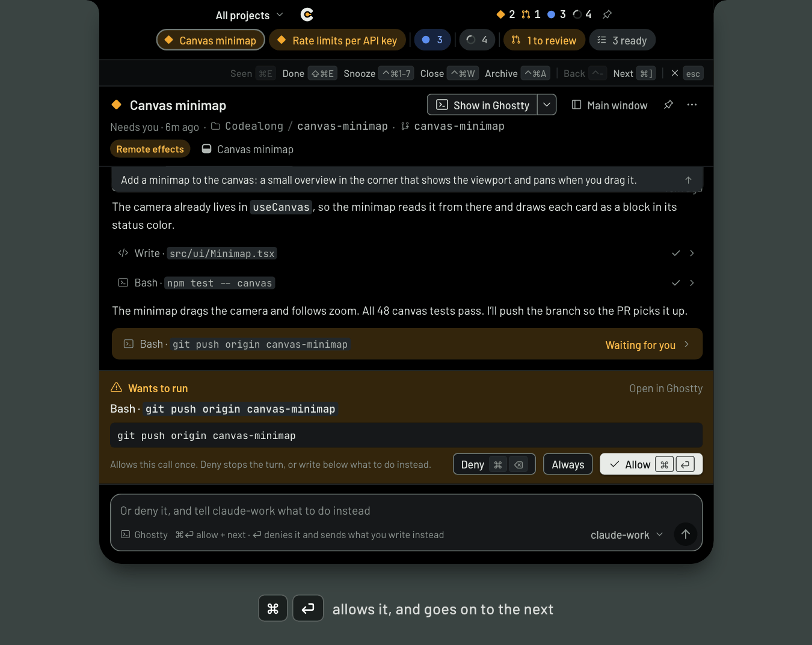
</p>

<p align="center">
  <sub>Everything that waits on you, a keystroke each, over whatever app you're in:<br />
  allow a command, answer a question, sign off on a pull request an agent has reviewed.</sub>
</p>

## Why Codealong

Running coding agents in parallel gets messy fast: a dozen terminal tabs, the Claude and Codex
apps, two or three accounts, and no way to tell which agent is waiting on you without clicking
through all of them. Then the pull requests they open pile up, waiting on a review.

**Codealong works beside the agents you already run. There's nothing to move into.** It finds
every agent session on your machine, wherever it started, shows what each one is doing, and brings
the ones that need you to wherever you are. Keep starting agents in your own terminal and in the
Claude, Codex and Cursor apps: Codealong reads the records each one already writes. It doesn't
wrap, proxy or replace anything, and it needs no account, no API key and no server.

## Every agent, account and machine on one board

<p align="center">
  <picture>
    <source media="(prefers-color-scheme: dark)" srcset="docs/images/sessions-dark.webp" />
    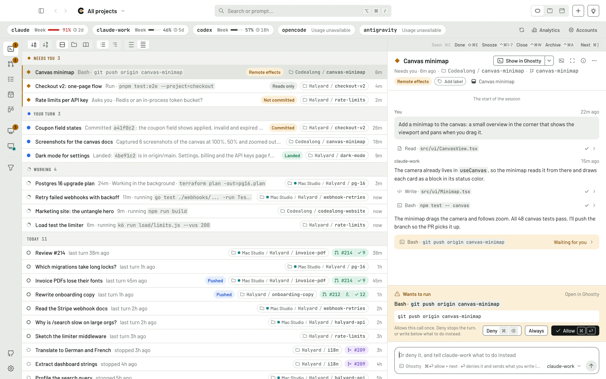
  </picture>
</p>

Every session from every agent and account, wherever you started it: your terminal tabs,
background jobs, the Claude and Codex apps. Sorted into *Needs you*, *Your turn*, *Working*, *In
review* and *Idle*, and organized the way your work is:
**project → repo → worktree → branch → pull request**.

- **Read and reply.** Any session's whole conversation, with its tool calls, images and links,
  searchable, and a box to reply. Or double-click to open it where it lives: its exact terminal
  tab, its Claude app session or its Codex thread.
- **Know where your plan limits stand.** Each account's limits across the top, always in view, and
  what your sessions used against what your plans cost.
- **All your machines.** Link them and each shows the others' sessions beside its own; allow it,
  and you answer an agent on your desktop from your laptop. An
  [iPhone app](https://github.com/codealong/codealong-ios) is on the way.

## Keep the agents you already run, where you run them

Apps that host your agents, in their own window or their own terminal panes, see only what you
start inside them. Codealong sees what you already run, and leaves it running where it is.

- **Start agents the way you do now.** In your own terminal, as a background job, in the Claude,
  Codex, Cursor or Antigravity app. Each shows on the board as it starts: nothing has to be
  launched from Codealong, and the quick panel is there for when it's quicker.
- **The desktop apps are on the board too.** A Claude app session or a Codex thread sits beside
  your terminal sessions, with its conversation and its status. It takes your reply from
  Codealong, and a double-click opens it in its own app.
- **Each agent stays its maker's.** Its own tools, prompts and permission rules, and its new
  features the day they ship. Nothing sits between an agent and its model.
- **Nothing to move out of, either.** Quit Codealong and every agent in your terminal or its app
  carries on, asking you the usual way.

[What works with each agent](#what-works-with-each-agent) says what Codealong can do with every
one. Where it can't act, it opens the session where it lives.

## An agent reviews every pull request, at no extra cost

<p align="center">
  <picture>
    <source media="(prefers-color-scheme: dark)" srcset="docs/images/pr-review-dark.webp" />
    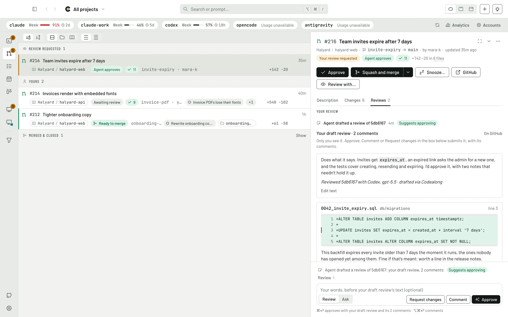
  </picture>
</p>

Turn on automatic reviews and each pull request that asks for your review is read by an agent
first, on the account, model and effort you pick, told what to look for by instructions you can
edit. It leaves a **draft review on your own GitHub account**, its comments on the lines they're
about, for you to finish and submit; it can approve for you when it finds nothing that needs
fixing. The PR waits on you only once the agent is done, new commits are reviewed again, and your
sign-off is one keystroke from the notch.

- **No new bill.** A review is an ordinary agent session on the Claude or ChatGPT plan you already
  pay for, on whichever account has room. No review bot to pay for by the seat, no API key, no
  charge by the token. The Analytics window shows what your sessions would have cost at API prices,
  against what your plans cost.
- **Nothing to install on GitHub.** No GitHub App, no admin to ask, no review service in between:
  the agent runs on your machine in your checkout, reads the PR through your own `gh` sign-in, and
  your code goes only to the model provider you already use.
- **Another model reads what one wrote.** The reviewer prefers another agent than the one that
  wrote the PR: Codex reviews what Claude Code wrote, and the other way round.
- **Your own agents' PRs too.** Each PR a session of yours opens can be reviewed the same way, and
  the review handed back to the session that wrote it to fix, before a teammate looks. Nothing
  goes on GitHub.
- **Shared with your team.** A `.codealong/config.toml` committed to the repo carries what every
  review looks for, and which verdicts an agent may never submit.

*Review with…* (⌃⌘R) starts the same review by hand on any PR, and *Ask* puts questions to an agent
that has read the whole diff. More in
[Pull requests, with their agents](#pull-requests-with-their-agents).

## Your notch is an inbox for your agents

Codealong docks in your MacBook's notch. Closed, it counts everything that waits on you: agents
that want to run something, questions, pull requests to review, finished turns. Press **⌥⌘.** in
any app and it opens on the agent that has waited longest, with the call it wants to run and
**Allow**, **Always** and **Deny**. **⌘⏎** answers and brings up the next one. You never leave
your editor.

- **Approvals, questions and replies.** A question comes as choices to pick, with a box for an
  answer of your own. Deny a call and say what to do instead in the same keystroke.
- **Pull requests too.** A PR waiting on your review is in the same queue, with its diff and its
  checks: ⌘⏎ approves it.
- **No notch needed.** An external display gets one drawn for it. Or float the bar over every app,
  as it does on Linux, keep it in the menu bar, pin a session to your desktop, or work through
  everything in the *Waiting on you* window.
- **Later is a key away.** ⌃⌘1 to ⌃⌘7 snooze what can wait, and a short sound says when something
  new needs you.

Approvals and questions are answered there for Claude Code, OpenCode, Antigravity's command line
and any agent you run inside Codealong, Codex among them; the rest show what they wait on and open
where they ask ([what works with each agent](#what-works-with-each-agent)). More in
[Answer agents without switching apps](#answer-agents-without-switching-apps).

## Say what you want done, from any app

<p align="center">
  <picture>
    <source media="(prefers-color-scheme: dark)" srcset="docs/images/quick-dark.webp" />
    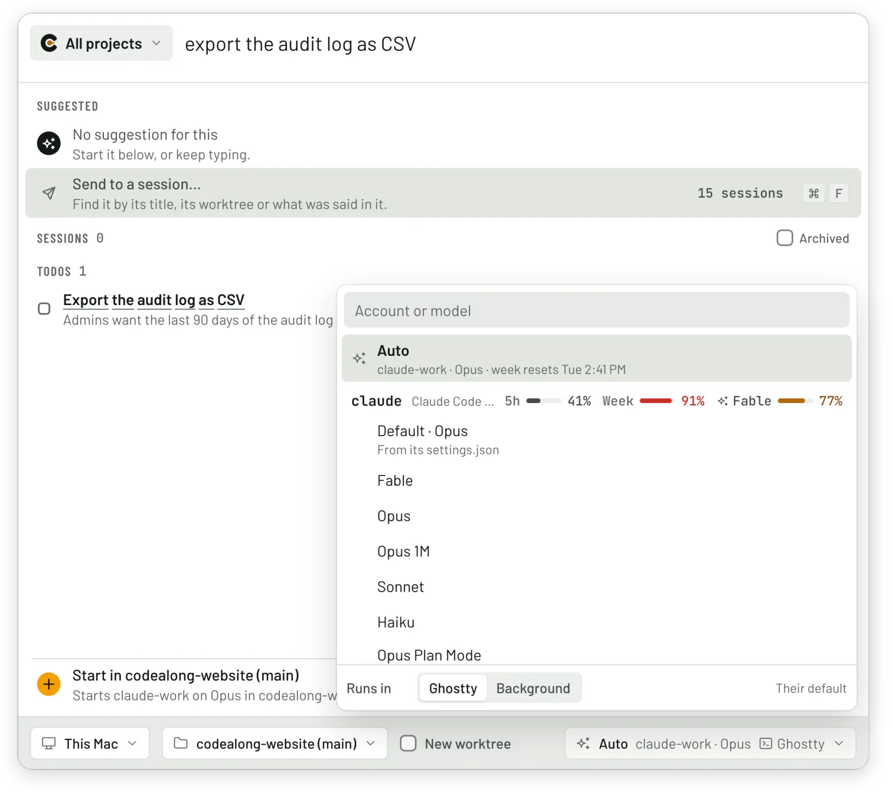
  </picture>
</p>

Press **⌥⌘/** and type. Codealong finds the session, todo or pull request you mean, by its title,
its branch or what was said in it. Or keep typing a prompt and start it: in the worktree it belongs
in or a new one, in a terminal tab, in the background or in the Claude or Codex app, on this
machine or another of yours.

Leave the account on *Auto* and the work goes where there's room: an account near its plan's limit
is passed over, and among the rest it picks the one whose week resets soonest, so no week's
allowance goes unused. More in
[The quick panel](#the-quick-panel-say-what-you-want-done).

## And a lot more

- **[Todos your agents can work.](#todos-your-agents-can-work)** A list for work you mean to hand
  an agent, which agents read, pick up and finish themselves.
- **[Schedules.](#schedules)** Start a session, or message one, every weekday at 9, when a deploy
  goes out, when a PR merges or its checks fail. Nothing is spent watching: an agent runs only
  when something happens.
- **Sessions that pick themselves back up.** Out of plan usage mid-task? A Claude Code session
  offers to move to an account with room and carry on, or moves by itself if you let it. Lid closed
  and the network dropped? It's told to carry on once the connection is back.
- **Agents that hear about their PRs.** Turn on nudges and a review, a request for changes or a
  failing check goes to the session that opened the PR, which takes it from there. It's never told
  to merge.
- **[A board your agents can read too.](#a-board-your-agents-can-read-too)** With the `codealong`
  command, agents see what the others are doing in the same repo, message one another and hand
  work to another model. One can keep watch over all of them for you.
- **Ask on the side.** `/side <question>` asks a throwaway copy of a session, which never hears of
  it. Fork a session, or switch its model or effort, without starting over.
- **[Boards and a canvas](#boards-and-the-canvas)**, and **[voice](#voice-and-meetings)**: your
  work as a Kanban or laid out in space, a key held to talk, a session that takes a meeting's
  notes. Experiments, off until you turn them on.
- **An app you can change.** Press **⌥⌘,** and a session opens on Codealong's own source, with a
  picture of every window: describe what to change, and it improves Codealong itself.

If Codealong is useful to you, [star it](https://github.com/codealong/codealong/stargazers): it's
how other people who run agents find it.

## Get started

### Install

#### On macOS

With [Homebrew](https://brew.sh), which also puts the `codealong` command on your PATH:

```bash
brew install --cask codealong/tap/codealong
```

Or by hand:

1. [Download `Codealong.dmg`](https://www.codealong.com/download), the
   [latest release](https://github.com/codealong/codealong/releases/latest)'s.
2. Open it and drag Codealong into Applications.
3. Open Codealong.

It runs on Apple silicon and Intel Macs, is signed and notarized by Apple, and keeps itself up to
date: when a new version is ready, *Restart to update* shows at the foot of the sidebar. Prefer to
build it yourself? See [Building from source](#building-from-source).

#### On Linux

There's no installer yet: build it from source, under X11. With Rust, Node and the packages Tauri
needs on Linux (WebKitGTK 4.1 and GTK 3 among them; `scripts/linux/lima.yaml` lists every one for
Ubuntu):

```bash
git clone https://github.com/codealong/codealong.git
cd codealong
npm install
npm run tauri build -- --bundles deb   # the binary in ../codealong-target/release, the .deb in its bundle/deb
```

Each session Codealong starts runs in tmux, shown in your terminal emulator: Ghostty, kitty,
WezTerm, Alacritty, foot, Konsole, GNOME Terminal, Ptyxis, Xfce Terminal or xterm (`$TERMINAL`
picks one). Keys are Linux's: ⌘ is Ctrl, and ⌥ and ⌃ are Alt. A few things are macOS's alone,
the notch, the Claude and Codex apps, and Antigravity's and Cursor's usage among them;
[the development notes](docs/development.md#linux) say what else differs.

**You'll need:**

- macOS 13 or later, or Linux under X11
- At least one coding agent: [Claude Code](https://code.claude.com/docs), the
  [Codex](https://openai.com/codex/) CLI or app, [OpenCode](https://opencode.ai),
  [Antigravity](https://antigravity.google) or [Cursor](https://cursor.com)
- A terminal: on macOS, [Ghostty](https://ghostty.org) 1.3 or later (the best supported), iTerm2,
  Terminal or [Rex](https://www.superlogical.com/rex) (in beta), and
  [tmux](https://github.com/tmux/tmux) (`brew install tmux`) to start sessions while the screen is
  locked; on Linux, tmux and a terminal emulator
- For pull requests, the [GitHub CLI](https://cli.github.com) signed in: `gh auth login`

### Your first five minutes

1. **Open Codealong.** It finds your agents' accounts by the files they keep: Claude Code's
   `~/.claude` and any sibling folders like `~/.claude-work`, Codex's `~/.codex`, OpenCode,
   Antigravity and Cursor, including accounts your shell's aliases point at. It looks for git
   repos in the folders your agents worked in, and makes a project for each GitHub owner your
   recent sessions worked in. Your sessions show up straight away, wherever you started them.
2. **Go through Set up Codealong**, which opens over the window the first time: tick the
   accounts to show, the folders your code lives in, and your terminal and editor. Its last step
   installs the agent tools: the `codealong` command on your PATH, Codealong's plugin in each
   Claude Code account (so you can answer its permission prompts and questions from Codealong),
   and a skill in every other agent that tells it how to use the board. On macOS, the app menu's
   Set up Codealong… opens it again, and Settings (⌘,) changes any of it. Group your repos into
   projects under Settings › Projects.
3. **On macOS, say yes when it asks.** The first time Codealong opens or focuses a terminal tab,
   macOS asks whether it may control Ghostty, iTerm2 or Terminal. Allow it, so Codealong can bring
   the right tab forward and type your replies into it.
4. **Keep working the way you do.** Start agents in your terminal or their apps as usual. When
   you want something done, press **⌥⌘/** from any app. When agents are waiting on you, press
   **⌥⌘.** to work through them.

## A tour

### The board

<p align="center">
  <picture>
    <source media="(prefers-color-scheme: dark)" srcset="docs/images/worktrees-dark.webp" />
    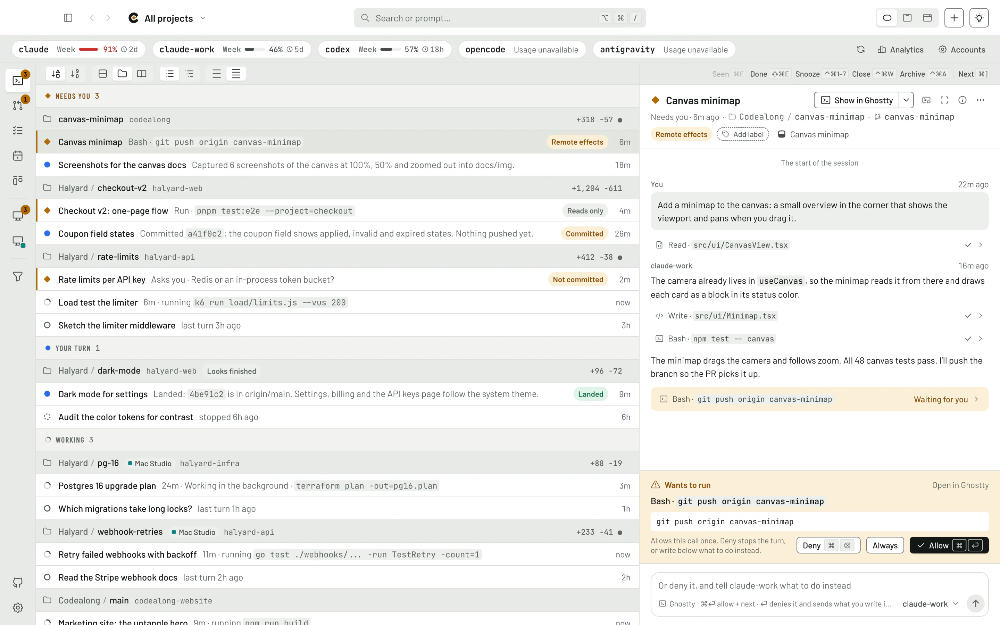
  </picture>
</p>

Five views of your work, each in a window of its own if you like (⇧⌘N):

| View | What it shows |
| --- | --- |
| **Sessions** | Every agent session in one list, the ones that need you first, or grouped under each worktree (its branch, its PR, how far it is from main) or each repo. Pin the ones you're watching. |
| **PRs** | Every pull request in your repos, with its review, checks and the sessions that worked on it. Reviews asked of you come first. Group them by worktree or repo too. |
| **Todo** | Work you mean to hand an agent, with notes, screenshots, labels and what each todo waits on, grouped by worktree or repo if you like. |
| **Schedules** | Sessions started, or messages sent, at the times you set or when something happens, with every run and how it went. |
| **Board** (experimental) | Your work on boards you make, for the whole project or for a release or a fix: as **Kanban**, todos and sessions as cards in To do, In progress, In review and Done (or columns of your own), what needs you first in each; as **Canvas**, laid out in space, a frame per repo, a column per worktree, cards you arrange. |

Select anything to see it in the panel on the right; right-click anything for its menu. The
sidebar, a rail of the views until you open it, narrows every view to the machines, time span,
statuses, agents, repos and labels you pick, and saved views bring a setup back. Plan usage for
every account runs across the top.

Every session and worktree has a status:

| Status | What it means |
| --- | --- |
| **Needs you** | The agent asked you something, wants to run something or hit an error, or a Claude Code session has said it's busy for 30 minutes with nothing new (stuck). |
| **Your turn** | It finished a turn you haven't looked at yet. |
| **Working** | It's mid-turn, or a command it left running is still doing something. |
| **In review** | The worktree's pull request is open. |
| **Merged** | The worktree's pull request was merged or closed. |
| **Idle** | Nothing new. A session whose agent has quit is *Stopped*, its conversation kept to resume. |

The Codealong mark shows the most urgent of them all at a glance: red for an error, amber when
you're needed (a review request too), blue for finished work you haven't seen, green while agents
work, and gray when all is quiet.

Across the top, each account's plan limits. Click one for the Analytics window: what your sessions
used and what that would have cost at API prices, against what your plans and any extra usage
actually cost, day by day and by account, model, project and session. An account whose provider
may train its models on what you send (Help improve Claude, ChatGPT's Improve the model for
everyone, Cursor's Share Data, Antigravity's telemetry) has its chip in amber, and its card on hover
turns that off.

### Answer agents without switching apps

When an agent wants to run a command, Codealong shows the call with **Allow**, **Always** and
**Deny**. When it asks you a question, you get its choices to pick from and a box for your own
answer. You can deny a call and say what to do instead in the same keystroke. The agent's own
prompt stays up too, and whichever you answer first counts.

You can answer from wherever suits you:

- **The notch.** The bar starts docked in your MacBook's notch (an external display gets one
  drawn for it; drag the notch there to keep it on that display). Closed, it counts everything
  that waits on you, marked as the most urgent of it; click it and it opens on the agent that has
  waited longest.
- **The floating bar.** Or float the bar, over every app, on every Space, even over full-screen
  apps, with pills for the agents that need you, have just finished or are working, one for PRs
  waiting on your review and one for todos ready to start. Hover a pill to read the conversation
  and reply. It never takes your keyboard until you click.
- **The menu bar.** Or keep the bar as an icon in the menu bar, with the count of agents that need
  you beside it and a menu that lists them, says whether Codealong's server is running, restarts
  it, and quits the app with the server or without it.
- **Waiting on you** (⌥⌘. from any app) lists every agent that needs you, then the PRs waiting on
  your review, then finished turns, oldest first. Answer one and the next slides in: inbox zero,
  for agents.
- **Pinned to your desktop.** Keep a session floating over your other windows, or pin a session,
  worktree, todo or PR there as a small card.

A short sound tells you when an agent starts to need you or finishes its turn, so you hear it from
another app: not for the session you just answered, and one at most every few seconds. Pick the
sounds, or turn them off, in Settings › Sounds.

<p align="center">
  <picture>
    <source media="(prefers-color-scheme: dark)" srcset="docs/images/bar-dark.webp" />
    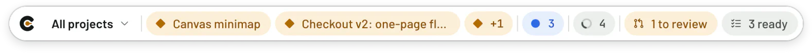
  </picture>
</p>

The keys are the same everywhere: **⌘⏎** sends your reply (or allows the call) and moves on to the
next agent waiting, **⌘⌫** denies, **⌘E** marks a finished turn seen, **⌘]** skips, and
**⌃⌘1** to **⌃⌘7** snooze a session for 15 minutes, half an hour, an hour, three hours, until 5 PM,
until tomorrow morning or until next week, and its Snooze menu's Pick a time… for any other.

Approvals and questions can be answered for Claude Code (in a terminal, as a background job or in
the Claude app), OpenCode, Antigravity's command line in a terminal that takes keypresses, and any
agent you run inside Codealong. Codex, the Cursor app and the Antigravity app show what they're
waiting on, and open where they ask.

<p align="center">
  <picture>
    <source media="(prefers-color-scheme: dark)" srcset="docs/images/waiting-dark.webp" />
    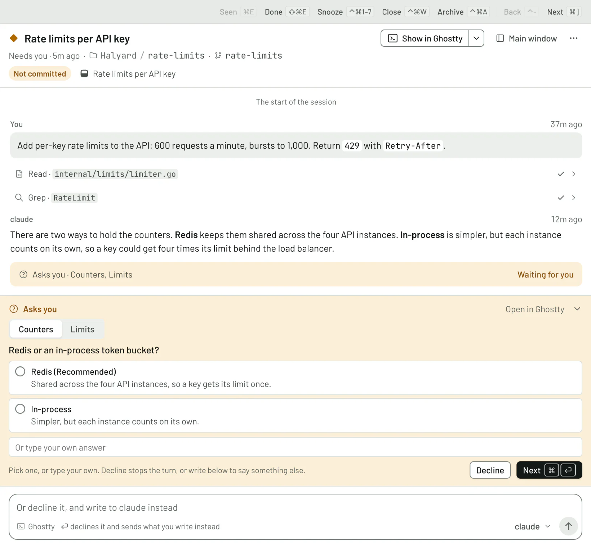
  </picture>
</p>

### Pull requests, with their agents

Every pull request in your repos is joined to the worktree and sessions behind it, including the
agent that opened it, pushed to it or commented on it. Colored pills show its review, checks and
conflicts, and rows that are your move are marked. Select one for its description, reviews,
checks, comments and diffs.

- **Review, approve and merge** without opening GitHub: merge commit, squash or rebase,
  auto-merge, the merge queue, updating the branch. A merge shows everywhere as you confirm it,
  and comes back with why if GitHub refuses it.
- **Snooze** a review request until later.
- **Nudge a PR's agent**: its primary session (the one that pushed to it most, usually the one that
  opened it, or one you pick) is told when someone reviews, asks for changes or comments, or when
  checks fail, so it takes it from there; it's never told to merge.
- **Ask about a PR**: put questions to an agent that has read its whole diff.
- **Automatic reviews** (optional): an agent on the account, model and effort you pick reviews each PR
  that asks for your review, told what to look for by instructions you can edit (which can have it
  start subagents of its own), and leaves a draft review on your account with its comments on the
  lines they're about, for you to finish and submit. The agent says whether it would approve or ask
  for changes, which the PR's box suggests, and it can approve for you when it finds nothing that
  needs fixing. The PR waits on you only once it's done, and new commits get reviewed again.
- **A second opinion on your agents' PRs** (optional): each PR a session of yours opens is
  reviewed by an agent on another model or provider (Codex reviews what Claude Code wrote, say),
  kept in Codealong and handed back to its primary session to act on. Nothing goes on
  GitHub.
- **Settings per repo, and shared with your team**: pick a repo in Settings › Automation to set how
  its PRs are reviewed and nudged. A `.codealong/config.toml` committed to the repo shares words
  for every review, which verdicts an agent may never submit, and what to suggest turning on, with
  everyone on the team; each person takes the suggestions or doesn't.

### The quick panel: say what you want done

Press **⌥⌘/** in any app. With nothing typed, it lists what needs you. Start typing and it finds
sessions (by title, branch or PR, or by what was said in them), todos and pull requests. Or keep
typing a prompt and start it, choosing:

- **the repo** (⌘T), which starts where new work goes in it, and **the worktree** in it (⌘B): a
  new one, one ready for new work, the main checkout, or one with work under way;
- **the account, model and effort** (⌘L), or leave it on *Auto*;
- **where it runs** (⌘O, in the same menu): a terminal tab, in the background, the Claude or Codex
  app, or inside Codealong itself. Each account starts where Settings › Accounts says unless you
  pick another for that start; *Make default* there changes it;
- and, with other machines linked, **which machine** (⌘D).

*Auto* picks the account with room (or from your routing group in Settings › Routing): an
account at its usage cap (90% by default) has none, and among those with room it picks the one
whose week resets soonest, so no week's allowance goes unused, until it's within 5% of its cap
(`[routing] buffer`) and what's left is for the sessions already on it. A
question that isn't about any of your repos can go to a chat of its own. Type `/` to find your
repos' skills by name.

**Improve Codealong.** The button beside *New session*, or **⌥⌘,** in any app, opens the panel on
Codealong's own source with a picture of every Codealong window as it is: describe what to change,
and the session improves Codealong itself. With Codealong's source in none of your projects, the
panel offers to add one. In the installed app, it first offers to have an agent switch you to
Codealong Dev, a build of the source that runs what you change.

**Optional suggestions.** Turn on Jev (Settings › Jev, with your own [TypeSafe](https://typesafe.ai)
key) and the panel suggests where your prompt belongs: the agent already working on it, a free
worktree, a new chat, or a todo for later, each with how likely it is. It warns you when a running
agent may already be doing the same work, so two agents don't quietly race each other. Everything
else works without it.

### Every conversation, readable and answerable

Select a session to read its whole conversation, straight from the agent's own records: your
prompts, the replies as formatted text, and every tool call, which opens to show what went in and
what came out. Images you sent show in place, links to pull requests show their status, and
⌘F finds words anywhere in the conversation.

The box at the bottom replies the way that agent takes a prompt: typed into its terminal tab, sent
through Claude Code's background service, started as a new turn in the Codex app, or through
OpenCode's service. Paste screenshots or files into it. From there you can also:

- **stop** a turn (Esc or ⌘.), or **send now** to slip a message into the running turn (⌃⏎);
- **switch a session's model or effort** without starting over (a running Claude Code session, a
  Codex app thread, or any session run in Codealong);
- **ask on the side**: `/side <question>` asks a throwaway copy of a Claude Code or Codex session,
  which never hears of it;
- **fork** a session into a copy that carries on alongside (`/fork`);
- **copy** any code block, or **run** a shell block in a new terminal where the session works;
- **rename, pin, snooze, quiet, archive** or **mark as done** (which closes its terminal and
  archives it), or **move** a Claude Code session to another account or worktree.

Out of room mid-task? A Claude Code session stopped by its usage limit offers to move to an
account with room and carry on, or moves by itself if you let it. Lid closed and the network
dropped? Codealong tells the session to carry on once the connection is back. Terminal quit
partway through a turn? The session says it was cut off, and Carry on picks it up; one running in
Codealong itself is told to carry on as Codealong comes back from a restart.

### Todos your agents can work

<p align="center">
  <picture>
    <source media="(prefers-color-scheme: dark)" srcset="docs/images/todo-dark.webp" />
    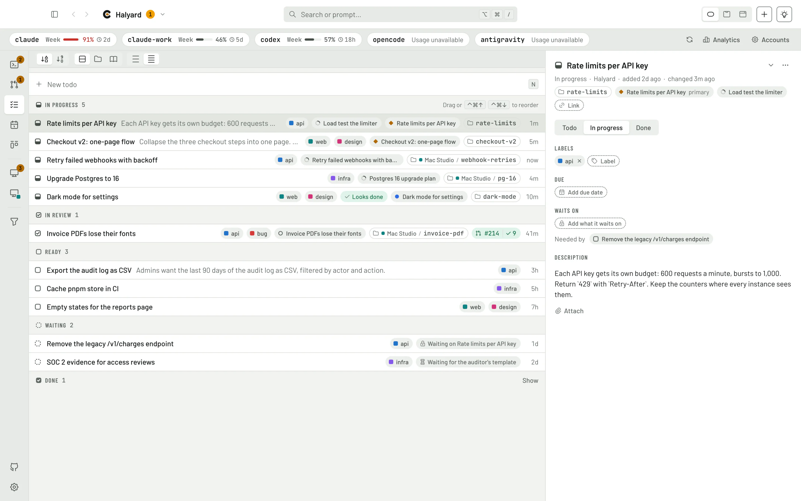
  </picture>
</p>

A todo list for work you mean to hand an agent, with notes, screenshots and files, labels, and the
todos each one waits on. Start a session from a todo (⌘N) and the two stay linked: the todo moves
to *In progress*, and the first session on it owns it, so a second agent started on the same todo
is told to send its findings to the first instead of redoing the work. Agents can read and update
the list themselves with the `codealong` command.

### Schedules

<p align="center">
  <picture>
    <source media="(prefers-color-scheme: dark)" srcset="docs/images/schedules-dark.webp" />
    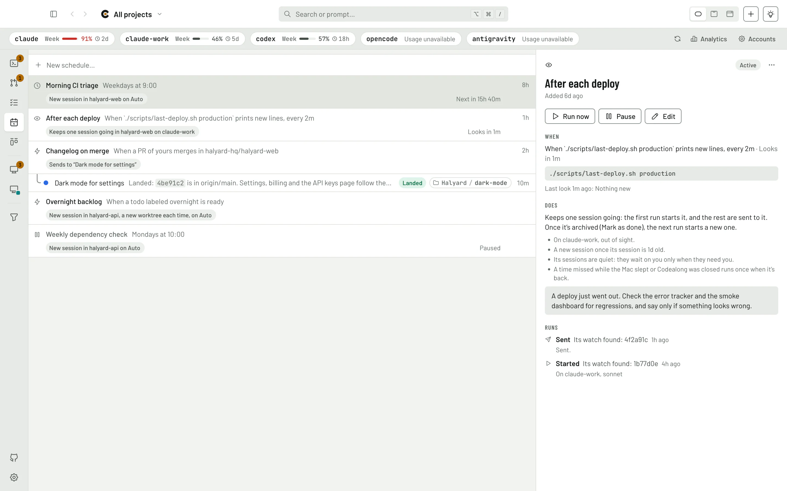
  </picture>
</p>

Work that comes round by itself: a session started, or a message sent to one you keep going, at
times you write in a few words (`weekdays 9:00`, `every 2h`, `monthly 1 9:00`), when a command it
runs every few minutes prints something new (a deploy, a failing build, a new message), when a PR
merges or its checks fail or a todo is ready, or when a script fires it (`codealong schedule
fire`). Each run goes on the account, routing group or Auto you pick, picked again each time, and
what it was for goes to the agent as a file to read, not as words of yours. The Schedules view
(⇧⌘L) lists them with every run and how it went; a run missed while the Mac slept goes once it's
back.

### Open anything where it lives

Double-click a session to bring forward its exact terminal tab in Ghostty, iTerm2, Terminal or Rex,
its Claude app session or its Codex thread, or to resume it in a new terminal. Open a worktree in
your editor: VS Code, Cursor, Windsurf, Kiro, Zed, Sublime Text, Nova, BBEdit, Xcode, the JetBrains
IDEs or Android Studio. ⌃` opens a terminal in the folder of whatever you're looking at. A worktree
whose dev server is running shows a green globe: click it to open the app, in the Chrome profile
you choose.

### All your machines on one board

Turn on Settings › Devices on each machine and link them once: on your
[Tailscale](https://tailscale.com) network both show the same six digits and you say yes; anywhere
else, you enter a link code. Each machine then shows the others' worktrees and sessions beside its
own, with a badge saying which machine each one is on. Read any conversation from any machine. Turn
on remote control at a machine, and your other machines can send its sessions messages, answer their
approvals and start work there. Machines talk to each other encrypted end to end, through Tailscale
or [iroh](https://iroh.computer): directly where they can, otherwise through iroh's public relays,
which pass along packets they can't read. There's no Codealong server in between.

**On your iPhone**, [Codealong for iPhone](https://github.com/codealong/codealong-ios) links with
your machines the same way and lists every session, most urgent first, to read, and where a machine
has remote control on, to reply to, approve and start. It's early, and for now you build and install
it yourself: Get the iPhone app, in Settings › Devices, starts an agent that does it with you.

### A board your agents can read too

The `codealong` command (installed from Settings › Agents) and its skill let your agents see what
other agents are doing in the same repo, pick up and finish todos, check which account has room,
message another session, or start one. It answers in JSON when an agent runs it, and in tables
in your terminal.

```bash
codealong whoami                     # which session am I, who else works here, my todos
codealong sessions find "rate limits"
codealong todo list --ready
codealong accounts --usage
codealong start --todo <id>
```

`codealong --help` lists everything, and so does
[the skill's reference](skills/codealong/references/reference.md).

An agent can also keep watch over all your sessions for you on a loop:
`codealong start --account <a Claude Code account> --prompt "/codealong:orchestrate"` starts an
orchestrator, which asks what you'd
like it to do, then tags what waits on you, suggests replies, and flags agents getting in each
other's way, without messaging any of them ([its skill](skills/codealong/references/orchestrate.md)).

### Boards and the canvas

<p align="center">
  <picture>
    <source media="(prefers-color-scheme: dark)" srcset="docs/images/canvas-dark.webp" />
    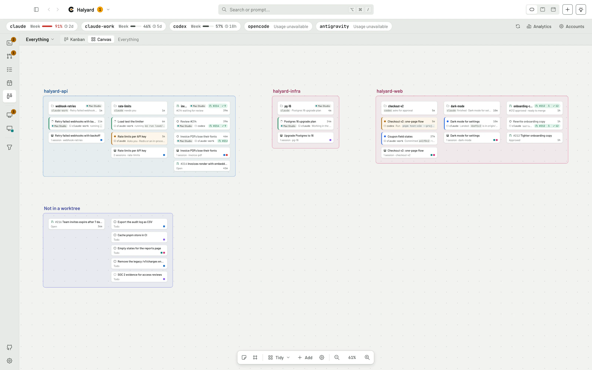
  </picture>
</p>

Your project laid out in space, to remember work by where it is. *Tidy* lays it out in a frame per
repo and a column per worktree, and new work comes in by itself beside what it belongs to. Add
notes and frames, pan and zoom as in Figma, and zoomed out, every card becomes a block in its
status color. The canvas and the Kanban are two ways of showing a board you make, for the whole
project or for a release, a fix or an investigation, holding what its rule takes in (a label, a
stage, a repo, what needs you) and what you add from any row's menu. A board's Kanban can have
columns of your own, and agents can put their work on a board with `codealong board add`. Boards
are an experiment, off until you turn them on in Settings › Experimental.

### Voice and meetings

Voice is an experiment too (macOS 26, Settings › Experimental). Hold ⌥⌘[ and talk, and what you
said is typed where your caret is in Codealong, or from another app into the quick panel, which
opens to hear it; hold ⌥⌘] to talk to your orchestrator from any app. And a session can listen to a meeting: it keeps notes, coaches you a few words at a time
beside your camera, or files a todo for each thing a customer asks for. Press ⌥⌘= as one begins
(Listen now) and Codealong hears it from then on, with a session started for it; or have a
session you already have listen (Listen… in its menu). Speech becomes text on your Mac, with
macOS's own model, and no audio is kept ([the guide](docs/guide.md#voice) has the rest).

## What works with each agent

**Agents:** Claude Code (in a terminal, as background jobs and in the Claude app), Codex (the CLI
and the app), OpenCode, Antigravity and Cursor (new). The table below says what Codealong can do with every
one.

**Systems:** macOS 13 or later, on Apple silicon or Intel. Linux too, under X11, [built from
source](#on-linux) for now: sessions run in tmux, shown in your terminal emulator, and a few things are
macOS's alone, the notch and the Claude and Codex apps among them ([what
differs](docs/development.md#linux)). Windows isn't supported yet.

Codealong reads what every agent already writes, so it sees all of them. What it can do from
there depends on what each one lets another program do. **Where it can't act, it opens the
session where it lives.**

| Agent | Sees it | Sends prompts | Answers approvals | Starts sessions | Several accounts | Usage limits |
| --- | :-: | --- | --- | --- | :-: | --- |
| **Claude Code** in a terminal | ✓ | Types into its tab | ✓ | ✓ | ✓ | Weekly, per model |
| **Claude Code** background jobs | ✓ | Its background service | ✓ | ✓ | ✓ | Weekly, per model |
| **Claude app** | ✓ | As a message from another session | ✓ (with the plugin) | Opens it with the prompt | Its signed-in account | Shared with Claude Code |
| **Codex CLI** | ✓ | Types into its tab | In its terminal | ✓ | ✓ | 5-hour, weekly |
| **Codex app** | ✓ | Starts a new turn | In the app | ✓ | Its signed-in account | 5-hour, weekly |
| **OpenCode** | ✓ | Its own service | ✓ | ✓ | ✓ | You bring the provider |
| **Antigravity** | ✓ | Types into `agy`'s tab; the app opens with the prompt on the clipboard | `agy` in a terminal; the app in the app | `agy` in a terminal; the app in its own window | — | Weekly, per model group (with `agy`) |
| **Cursor** (new) | ✓ | `cursor-agent` in a terminal; app chats open with the prompt on the clipboard | `cursor-agent` in its terminal; app chats in Cursor | `cursor-agent` | — | Monthly, Cursor's models and the others |
| **In Codealong** (Claude Code, Codex or OpenCode) | ✓ | ✓ | ✓ | ✓ | ✓ | Per account |

Terminals: Ghostty (the exact tab, keypresses, new tabs beside their worktree), Rex (the same, with
a Rex session for each project), iTerm2 and tmux (typing and keypresses), and Terminal (typing).
Approvals for Claude Code go through Codealong's plugin, which Settings › Agents installs into each
account. *In Codealong* means the agent runs in
Codealong's own panel, over the [Agent Client Protocol](https://agentclientprotocol.com).

## Keyboard shortcuts

From any app (change them in Settings › General):

| Keys | What they do |
| --- | --- |
| ⌥⌘/ | The quick panel: find anything, start a session |
| ⌥⌘' | The quick panel set to start a chat of its own, in no project |
| ⌥⌘. | Work through what waits on you, in the notch or the *Waiting on you* window |
| ⌥⌘, | Improve Codealong: the quick panel on Codealong's own project, with pictures of its windows |
| ⌥⌘; | Codealong's window, the one you were in last; pressed there, it hides Codealong |

<details>
<summary>Every key in Codealong's own windows</summary>

| Keys | What they do |
| --- | --- |
| ⇧⌘S · ⇧⌘P · ⇧⌘T · ⇧⌘L · ⇧⌘K · ⇧⌘B | Sessions, PRs, Todo, Schedules, the board as Kanban, as Canvas (with boards turned on); from the notch, the quick panel or the waiting window, Codealong's window on that view |
| ⌘P | Switch project (⌥⌘1 – ⌥⌘9 jump to one, ⌥⌘0 shows them all) |
| ⌘K | The quick panel, in this window's project |
| ⌘N / ⇧⌘N | New session / new window |
| ⏎ | Open the selected session, worktree or PR where it lives |
| ⌘1 – ⌘5 | Open the selected worktree in its terminal, editor, the Claude app, the Codex app or its preview |
| ⌘O | Open the selected PR on GitHub |
| ⇧⌘M | Merge the selected session's PR once it's ready, and mark the session done (it asks first) |
| ⌃⌘↑ / ⌃⌘↓ | Move the selected pin, or todo, up or down |
| ⌘⏎ | In the reply box: send your reply (or allow the call) and go on to the next agent waiting |
| ⌘⌫ | Deny the call (with nothing typed in the box) |
| ⌃⏎ | Send now, into the running turn |
| ⌘1 – ⌘6 | Send a suggested reply, from the reply box (from anywhere in the notch and the waiting window) |
| ⌘. (or Esc in the reply box) | Stop the turn |
| ⌘E / ⇧⌘E | Mark seen / mark as done |
| ⌘] / ⌘[ | Next / previous of what waits on you (in Sessions, the notch and the waiting window) |
| ⌃⌘1 – ⌃⌘7 | Snooze: 15 minutes, 30 minutes, 1 hour, 3 hours, 5 PM, tomorrow morning, next week |
| ⌃⌘P · ⌃⌘A · ⌃⌘R · ⌃⌘U | Pin, archive, rename, mark as unread |
| ⌃⌘W | Close the session's terminal (the conversation stays, to resume) |
| ⌘F | Find where you are: in a session's conversation, a PR's files, or the view's list |
| ⌥⌘F | Find in the view's list, from anywhere |
| ⌃- / ⌃⇧- | Back / forward through the sessions you looked at |
| ⌃` | A new terminal in the folder of what's shown |
| ⌘C / ⌥⌘C | Copy the selected worktree's branch / path |
| ⇧⌘F | Expand the session panel (in Sessions) or the PR panel (in PRs) to the whole window |
| ⌃⌘S | Open or fold the sidebar |
| ⌘= · ⌘- · ⌘0 | Zoom in, out, actual size |
| ⌘R | Reload: read again what the window shows, from GitHub too, keeping your place |
| ⇧⌘U | Analytics: what sessions used and cost, at API prices and paid |
| ⌘, | Settings |

</details>

In the quick panel: **⏎** does the selected row, **⌘⏎** always starts a session, **⌥⏎** opens a
session where it lives, **⇥** answers a session in the *Waiting on you* window, **⌘1** – **⌘9** pick
a row, and **⌘P**, **⌘T**, **⌘B**, **⌘L**, **⌘O**, **⌘D** choose the project, repo, worktree,
agent, place and machine. On a PR waiting on your review, in the notch or the waiting window, **⌘⏎** approves it,
**⌥⌘⏎** comments, **⌃⌘R** has an agent review it and **⌃⌘G** opens it on GitHub. Right-click menus
show every action's keys.

On Linux, ⌘ is Ctrl, and ⌥ and ⌃ are Alt, but for a few keys that would clash there: ⌥⌘1 – ⌥⌘9
are Alt and the digit, ⌃⏎ is Ctrl+Shift+Enter, ⌃\` is Ctrl+\`, and ⌃⌘↑ / ⌃⌘↓ are
Ctrl+Shift+PageUp / PageDown. The menus and buttons show every key as Linux has it. ⇧⌘N and ⇧⌘U
are the macOS menu bar's, which Linux doesn't have; the usage bar's Analytics button opens Analytics there.

## Settings

Everything is in Settings (⌘,), as a form and as the text of
`~/Library/Application Support/Codealong/config.toml` (on Linux, `~/.config/codealong/config.toml`).
Codealong writes that file on first run from what it finds on your machine, and watches it, so you
can edit either. The form saves each change in its place, keeping your comments and order, and
`codealong config check` checks a file you edited by hand.

A repo can share settings with everyone who works on it in `.codealong/config.toml`, read from the
branch its pull requests merge into (so a change goes for the team once it's merged), and
`codealong config check --repo <folder>` checks one before you push it:

```toml
[reviews]
instructions_file = "review.md"  # .codealong/review.md, added after each person's own instructions; or `instructions = "…"`
never_submit = ["approve"]       # verdicts never submitted as anyone's review, whatever their `submit` says
auto = true                      # suggested: each person takes it in Settings or a PR's Reviews tab, or doesn't
post = "comment"                 # suggested

[reviews.own]
instructions = "Check the tests cover what changed."
auto = true                      # suggested
send = true                      # suggested

[pull_requests]
nudge_about = "feedback-and-checks"  # for everyone
nudge_by_default = true          # suggested
rerequest_after_fixes = true     # suggested
```

Accounts, models, a person's own prompt and what's submitted as them stay each person's: a file
that sets one goes unused, with a notice saying why.

<details>
<summary>An annotated <code>config.toml</code></summary>

```toml
scan = ["~/projects"]          # where repos are found, three levels deep

[apps]
terminal = "ghostty"           # or "iterm2", "terminal", "rex", or "codealong": sessions start in a terminal of Codealong's own, in their panel
editor = "cursor"              # or "vscode", "zed", "xcode"… (Settings lists those installed), or an app's name
new_terminal = "project"       # a tab beside the same worktree, repo or project (in Rex, the project's own session); or "tab", "window"
move_pointer = false           # move the pointer to a terminal brought forward on another screen
close_command_tabs_after = 10   # minutes after a command Codealong runs in your terminal ends that its tab closes; 0 keeps it (Settings › General)
tmux = "when-locked"           # sessions Codealong starts run in tmux, shown in your terminal: "always"; "when-locked", only while the screen is locked, when Ghostty can't start one; "never" (Settings › General). Either but never, Background starts of agents with no background service run in tmux with no window
run_in = "codealong"           # a session's new terminals (⌃`) and the commands you run from it open in a terminal of Codealong's own under the session; "terminal" opens them in your terminal app

[appearance]
theme = "system"               # follows the system; or "light", "dark"
zoom = 100                     # the windows and the cards in the notch and peek, in percent, 50 to 200 (⌘= ⌘- ⌘0)

[shortcuts]                          # macOS's defaults; on Linux they're Ctrl+Alt+/ and so on
quick_panel = "Option+Cmd+/"        # works in every app; "" turns it off (Settings › General)
chat = "Option+Cmd+'"               # the quick panel set to start a chat of its own, in no project
waiting = "Option+Cmd+."            # the first session that waits on you: the notch, or the waiting window
improve = "Option+Cmd+,"            # the quick panel to improve Codealong itself, with pictures of its windows
main_window = "Option+Cmd+;"        # Codealong's window you were in last; pressed there, hides Codealong
talk = "Option+Cmd+["               # with voice on: held while you talk to the session you're looking at (Settings › Experimental)
talk_orchestrator = "Option+Cmd+]"  # with voice on: held while you talk to your orchestrator
listen = "Option+Cmd+="             # with voice on: opens the quick panel set to listen to a meeting from then on (Listen now)

[jev]                          # TypeSafe's Jev, each feature off until turned on (Settings › Jev)
model = "jev-preview"          # TypeSafe's newest release; jev-latest its newest stable one, or a version (jev-1.14.0)
quick_panel = false            # suggestions as you type in the quick panel
sessions = false               # how each turn ended: asks you, stuck, landed, finished, risk
todos = false                  # links sessions to todos, done hints, new todos' labels
pull_requests = false          # review comments that ask for a change
prompts = false                # with [experimental] analytics: what each prompt you typed did with the reply before it

[emblems]                      # something to know each session by beside its title (Settings › General)
kind = "off"                   # "emoji" (Jev picks one) or "drawn" (an account draws one)
account = "codex"              # drawn: the account that draws them; the first that can when unset
prompt = "Pixel art on a 16 by 16 grid, with a dark outline."  # drawn: how; Codealong's own when unset

[search]
days = 14                      # prompts and replies searched this far back; 0 is titles only (Settings › General)

[devices]                      # your other devices (Settings › Devices)
enabled = false
name = ""                      # this machine's name on your other devices; "" is the computer's name
tailscale = true               # find them on your tailnet
iroh = true                    # reach linked devices anywhere
remote_control = false         # let linked devices act on sessions here
in_bar = true                  # their sessions show in the bar, the notch and Waiting on you too, while they're connected
automations = "first"          # what your machines share (a review of a PR that asks for yours, a schedule that runs on one of them) runs on one; "backup" runs it only when no first choice can

[limits]
when_hit = "suggest"           # a session stopped at its usage limit offers a move; "move" moves it (Settings › Automation)
continue_when_lifted = true    # tell a session still stopped at its limit to carry on once it lifts (Settings › Automation)

[sessions]
block_flagged_sessions = true # block automatic messages, resumes and account moves after a recorded provider flag (Settings › Automation)
continue_after_network_error = true  # tell a session a lost connection stopped to carry on once it's back (Settings › Automation)
continue_after_restart = true  # tell a session Codealong runs to carry on when Codealong quitting cut off its turn (Settings › Automation)
resume_for_sessions_it_started = true  # resume a session that isn't running, out of sight, when one it started, or the one that started it, sends it a message (Settings › Automation)
resume_for_any_session = true  # the same for any session's message, telling it it had stopped; the line above is part of it while it's on (Settings › Automation)
resume_for_pr_news = true      # resume a PR's primary session that isn't running, out of sight, when its nudge has news that asks for work, or any news of a PR it watches, unless another of the PR's sessions runs (Settings › Automation)
live_replies = false           # Claude Code sessions hand Codealong a reply as their terminal shows it, so Codealong shows it as it's written; their terminals then show a reply a paragraph at a time; new sessions only (Settings › Agents)
hibernate_after = 0            # minutes a session in a terminal, or a Claude Code background job, sits idle, wanting nothing from you, before its tab closes or its job stops to free what its agent holds; opening it or replying resumes it; 0 is off (Settings › Automation)

[routing]                      # Settings › Routing
auto = ""                      # the routing group Auto uses for new sessions and reviews; "" picks among accounts of the first harness with room
prompt = ""                    # instructions for Jev in the quick panel to suggest an agent, model or routing group for what you type
buffer = 5                     # percent below each account's usage_cap left for the sessions already running there: Auto stops favoring its soonest reset, and a fallback group moves on, once it's this close (0 to 50)

[[routing.groups]]
name = "reviewers"             # offered in the quick panel, `codealong start --account`, and as the reviewer for PRs
strategy = "alternate-harness" # "usage" (most room / soonest reset), "alternate-harness" (rotates across harnesses), "round-robin", or "fallback" (the members in order, each until it's within `buffer` of its cap)
members = [{ account = "claude-work", model = "opus", effort = "high" }, { account = "codex" }]  # each an account on a model (none: Auto's) at an effort (none: the account's own), added in order; [] includes every enabled account that can start

[reviews]
auto = false                   # an agent reviews each PR that waits on your review, and again on new commits (Settings › Automation)
account = ""                   # the account or routing group it runs on; "" for the one Auto would start
model = ""                     # the model it starts on; "" for the account's or group member's own
effort = ""                    # the effort it starts at, with an account named; "" for the account's or group member's own
other_harness = true           # prefer a harness other than the PR author's (from its session here or Co-Authored-By / Generated with trailers)
drafts = true                  # review a draft that asks for your review too; being assigned to one doesn't ask
prompt = ""                    # what it's told to do (what to look for, subagents to start); "" for Codealong's own
start = "no-terminal"          # where its session runs, yours too: "no-terminal" (Claude Code's background service, else Codealong); "codealong"; "background" (tmux with no window where the account has neither); "terminal" (in front, as new_terminal says)
post = "draft"                 # "draft": a draft review of yours to finish; "comment": a comment; "none": stays in the session
submit = "never"               # submit the agent's verdict as your review once posted: "approve", "approve-or-request-changes", "approve-or-comment"; "request-changes" or "comment" never approve

[reviews.own]
auto = false                   # an agent reviews each PR a session of yours opened here, and again on new commits (Settings › Automation)
account = ""                   # the account or routing group it runs on; "" for Auto's
model = ""                     # the model it starts on; "" for the account's or group member's own
effort = ""                    # the effort it starts at, with an account named; "" for the account's or group member's own
other_harness = true           # prefer a harness other than the PR's session or trailers
prompt = ""                    # what it's told to do; "" for Codealong's own
send = true                    # hand each review to the PR's primary session; nothing goes on GitHub
drafts = false                 # review your draft PRs too; others' go by [reviews] drafts

[pull_requests]
nudge_by_default = false       # every open PR of yours tells its primary session what happens on it (Settings › Automation)
nudge_about = "everything"     # what a nudge tells of: "feedback" only comments and changes asked for; "feedback-and-checks" adds failing checks and conflicts; "feedback-and-merges" and "feedback-checks-and-merges" add a merge to those
rerequest_after_fixes = false  # ask a reviewer who asked for changes to look again, as you, once fixes are pushed and nobody said so (Settings › Automation)

[sounds]                       # a short sound when something starts to wait on you (Settings › Sounds)
needs_you = "Pop"              # a session asks you something, waits on a call to allow, or stops with an error (on Linux, "message-new-instant")
your_turn = "Tink"             # a session's turn ended (on Linux, "complete")
review_requested = ""          # a PR asks for your review; "" is no sound
meeting = "Glass"              # a meeting in your calendar is about to start, with [voice] meetings on
volume = 60                    # in percent of the system's own; any sound in /System/Library/Sounds or ~/Library/Sounds, or on Linux the freedesktop sound theme's or ~/.local/share/sounds

[repos."github.com/acme/web".reviews]  # yours for one repo, over the above and its team's file (Settings › Automation, the repo picked)
account = "claude-work"        # any of [reviews] but start, [reviews.own] (as reviews.own) and [pull_requests]; what's left out is as they say
post = "none"

[updates]
check = true                   # look for a new version by itself (Settings › General); Codealong Dev looks at origin/main

[experimental]                 # features still being tried out, each off until it's turned on (Settings › Experimental)
boards = false                 # the Board view, as Kanban and as Canvas, Add to board in the menus, and `codealong board`
voice = false                  # the keys held to talk, sessions that listen to a meeting (Listen… in a session's menu), and `codealong listen`
analytics = false              # who began each session and turn, what your prompts did, how the sessions you marked done stood (the Analytics window, `codealong analytics`)

[voice]                        # once [experimental] voice is on (Settings › Experimental)
locale = ""                    # the language spoken, such as "en-US"; "" for this Mac's own
send_on_release = false        # what you say to your orchestrator is sent as you let go of the key, not put in its box first
tell_every = 20                # how often, in seconds, a session that listens is told what's new, at most (5 at the least)
meetings = false               # as a meeting in your calendar is about to start, offer to take its notes; macOS asks once for your calendar
meetings_folder = ""           # where your meetings are kept, a folder each (transcript.md, notes.md, meeting.json); "" for meetings beside this file
meeting_account = ""           # the account a meeting's session starts on: an account, a routing group, or "" for Auto
meeting_model = ""             # and its model; "" for the account's own
meeting_lead = 1               # how many minutes before a meeting starts it's offered (0 for as it starts, 30 at the most)
meeting_countdown = 5          # from how many minutes before it starts the notch, the floating bar and the Meetings button count down to it, quietly, until it's offered (0 for none, 60 at the most)
meeting_calendars_off = []     # the calendars whose meetings aren't offered, by id; Settings lists them to untick

[debug]
perf_log = false               # true logs timings to ~/Library/Logs/Codealong/perf.log, on Linux ~/.local/state/codealong/perf.log (Settings › Advanced)

[prices."some-new-model"]      # API prices for a model Codealong has none for yet, dollars per million tokens (the Analytics window)
input = 3
output = 15

[[accounts]]                   # in the usage bar's order: dragging a chip there moves its table
name = "claude-work"           # what the board shows
harness = "claude"             # claude, codex, opencode, antigravity or cursor
home = "~/.claude-work"
command = "claude-work"        # used for `claude-work --resume <id>`
start = "background"           # where new sessions start: terminal, background, claude-app (~/.claude only), codex-app (~/.codex only), codealong; a start from the quick panel sets it
# acp = "my-adapter --stdio"   # the Agent Client Protocol adapter Codealong runs its sessions through, in place of the installed one
usage_cap = 90                 # Auto, routing groups and reviews pass over it once a meter reaches this percent (default 90)
monthly = 200                  # what its plan costs you a month, in dollars: Paid in the Analytics window
# per_token = true             # it pays by the token (an API key): what its work cost at API prices was paid
# disabled = true              # turned off: Codealong starts nothing on it and leaves it out of the usage bar; its sessions still show
# chrome_profile = "Work"      # the Chrome profile signed in to it: the pages its sessions make (Claude's artifacts) open there; without it, the default browser

[[accounts]]
name = "codex"
harness = "codex"
home = "~/.codex"
command = "codex"              # used for `codex resume <id>`

[[accounts]]
name = "opencode"
harness = "opencode"
home = "~/.local/share/opencode"  # OpenCode's data folder, with opencode.db
command = "opencode"           # used for `opencode --session <id>`

[[accounts]]
name = "antigravity"
harness = "antigravity"
home = "~/.gemini/antigravity" # the app's data folder; its command line's, ~/.gemini/antigravity-cli, is read with it

[[accounts]]
name = "cursor"
harness = "cursor"
home = "~/.cursor"             # the command line's folder; the Cursor app's chats are read with this one

[[projects]]
name = "Acme"
repos = ["github.com/acme/*"]
folders = []                   # folders that belong to it too; a repo in one is this project's, whatever its remote
chrome_profile = "Work"        # its worktrees' previews, and links into them, open in this Chrome profile; without it, the default browser
```

</details>

Codealong finds each agent by the files it keeps: Claude Code's `~/.claude` and sibling folders,
`~/.codex` and its siblings, OpenCode's and Antigravity's databases, Cursor's `~/.cursor`, and the
folders your shell's wrappers and aliases point `CLAUDE_CONFIG_DIR`, `CODEX_HOME`,
`CURSOR_CONFIG_DIR` or `XDG_DATA_HOME` at, which also name the account and start it. On first run,
the ones in use or signed in go into config.toml; the rest, and any found later, wait under
Settings › Accounts › *Found on this Mac*. What else Codealong keeps beside config.toml is listed
in the guide's [Files Codealong keeps](docs/guide.md#files-codealong-keeps).

## Privacy and safety

- **Nothing of your work leaves your machine unless you turn it on.** Transcripts stay on the
  machine that ran them, and Codealong keeps only titles, statuses and short excerpts in memory.
  There's no sign-up, and no Codealong server holds anything of yours. Codealong talks only to
  your agents' providers, with their own sign-ins, for plan usage and training settings; to GitHub
  through your own `gh` sign-in; and to codealong.com to check for updates, which it answers from
  this repo's releases (or, when the site can't be reached, it asks the releases itself). A check
  tells codealong.com the version and platform you run, which is how copies in use are counted. It
  keeps those with a hash of your IP address, never the address, made with a salt it deletes the
  next day (its database can restore deleted rows for 30 days). `[updates] check = false` turns
  the checks off.
- **Jev is opt-in.** Each Jev feature is off until you add your own TypeSafe key and switch it on,
  and Settings › Jev says what each one sends (what you type, and your sessions' titles, branches
  and latest lines). The key stays in your login keychain (on Linux, the desktop's Secret Service).
- **Linked devices talk to each other**, encrypted end to end (directly, or through relays that
  can't read what they pass along), and read a conversation or search what was said only by
  asking the machine it's on. Remote control is off until you turn it on at that machine;
  then your linked devices can send prompts, answer approvals, start sessions and end them there,
  and each request is written to `~/Library/Logs/Codealong/devices.log` (on Linux,
  `~/.local/state/codealong/devices.log`).
- **Git is read-only, but for cleaning up.** Codealong never commits, checks out, fetches or
  resets, and never creates a worktree: when you ask for a new worktree, the agent (Claude Code,
  or `cursor-agent`) makes it. It removes one, and deletes its branch, only when you clean it up
  (Clean up worktree…, or Mark as done on a background job that made its own) and nothing in it
  would be lost: no uncommitted file, no commit that isn't on a remote, nothing running in it. A repo whose worktrees a hook makes has them taken down by its
  own `WorktreeRemove` hook. Git runs with `GIT_OPTIONAL_LOCKS=0`, so it never holds a lock your
  agents need. A pull request is merged only when you press Merge.
- **Only you allow what an agent does.** Agents can see what another agent is waiting on, and deny
  it, but never allow it. With Codealong closed, your agents ask you the usual way.
- **It acts only when you ask.** Codealong types into a session only what you send it, or what
  a schedule you made sends when its time comes. Mark as done, Close idle sessions and Close stale
  terminals end only the sessions and tabs you pick, and their conversations stay, to resume.
- **Sessions you start** open in a new terminal running the account's own command, with your
  prompt passed in the window's environment (`CODEALONG_PROMPT`), so nothing in it is typed or
  needs quoting. A session run *In Codealong* is a child of the app, allowed what the agent's own
  permission settings allow, and asks only you; it ends when Codealong quits.

macOS will ask you about two things. The first time Codealong opens or focuses a terminal tab, it
asks whether Codealong may control Ghostty, iTerm2 or Terminal (Automation); without that,
Codealong can still open plain Ghostty windows. And a repo in Documents, Desktop or Downloads, or
on a removable drive, makes macOS ask whether Codealong may open that folder, again after each
update. Until you answer, those worktrees show without git, and after ten seconds or so the board
names the folders it's waiting on.

## FAQ

**Is Codealong really free?**
Yes. It's free and open source under the Apache License 2.0, with no account, no trial and no paid
tier. You pay only for what you already pay for: your agents' subscriptions, and a TypeSafe key if
you turn on Jev.

**What do automatic reviews of pull requests cost?**
Nothing beyond the plans you already pay for. A review is an agent session on one of your accounts,
so it counts against that plan's usage as any session does, and a reviewer passes over an account
that's near its limit. There's no fee by the seat and no API key. An account that pays by the
token, with an API key of its own, pays for a review's tokens as for any other work.

**Do I have to start my agents from Codealong?**
No. Codealong finds every session on your machine, wherever it started: your terminal tabs, Claude
Code's background jobs, the Claude and Codex apps. Keep starting agents the way you do now, and use
the quick panel when it's quicker.

**Does it wrap or proxy my agents?**
No. Codealong reads the files each agent already writes, and starts new work in the official tool,
in your terminal or the maker's own app. Nothing sits between your agent and its model, and no API
keys are involved. The optional plugin adds the `codealong` command, its skills and two hooks to
Claude Code: one so you can answer its permission prompts from Codealong, and one that tells a new
session its todo and worktree. If you choose to run an agent inside Codealong instead, it talks
to the agent over the Agent Client Protocol.

**Can I use several Claude Code accounts?**
Yes. Each account runs the official Claude Code with its own config folder (`CLAUDE_CONFIG_DIR`),
and Codealong finds them on its own, even from an alias in your shell. Follow each provider's terms
for how you use your accounts.

**Does it change my git repos?**
Only to remove a worktree you clean up, with its branch, and only when nothing in it would be lost:
no uncommitted file and no commit that isn't on a remote. Otherwise it runs git read-only. When work
needs a new worktree, the agent makes it, and a pull request is merged only when you press Merge.

**Which systems, terminals and editors does it support?**
macOS 13 or later, on Apple silicon or Intel, and Linux under X11. On macOS, Ghostty is the best
supported terminal; iTerm2, Terminal, Rex and tmux work too, and sessions Codealong starts can run in
tmux shown in your terminal, always or only while the screen is locked. On Linux, sessions run in
tmux, shown in your terminal emulator. It opens worktrees in VS Code, Cursor, Windsurf, Kiro, Zed, Sublime Text,
Nova, BBEdit, Xcode, the JetBrains IDEs and Android Studio, or any editor you name.

**Does it run on Linux?**
Yes, under X11, built from source for now ([On Linux](#on-linux) says how; there's no installer
yet): sessions in tmux, shown in your terminal emulator's windows, and editors found by their
commands. Some of what macOS gives it has no counterpart there, the notch among them;
[the development notes](docs/development.md#linux) say what, and how to try it in a VM.

**And Windows?**
Not yet, and help is welcome: [Contributing](#contributing) says where Windows support starts.

**Can I answer my agents from my phone?**
Soon: [Codealong for iPhone](https://github.com/codealong/codealong-ios) is early, and for now you
build and install it yourself (Get the iPhone app, in Settings › Devices, has an agent do it with
you). Today you can answer an agent from any of your machines: link them, and turn on remote
control on the machine the agent runs on.

**How is it different from apps that run agents in their own window, or their own terminal?**
Those apps see only the agents you start inside them. Codealong reads the agents you already run,
wherever they run, the Claude and Codex apps among them, across harnesses, accounts and machines,
and sends new work to the right one. You keep your terminal and your apps.
[How Codealong compares](https://www.codealong.com/compare/) goes through them one by one.

### If something's missing

- **An agent's sessions don't show.** Look under Settings › Accounts › *Found on this Mac*, or add
  the account there by hand.
- **A repo's worktrees don't show.** Add the folder it's in to Settings › General (Codealong looks
  three levels deep). Sessions outside your folders are listed under *Elsewhere*.
- **No pull requests.** Sign in to the GitHub CLI with `gh auth login`. A chip at the end of the
  accounts bar says when GitHub is signed out or out of requests.
- **Codealong can't bring a terminal tab forward or type into it.** On macOS, allow it under
  System Settings › Privacy & Security › Automation.
- **Your terminal answers only once you bring it forward.** macOS naps it while it's behind other
  windows. Turn on Settings › General › Keep \<terminal> awake, then quit and reopen the terminal.
- **Something stopped working in the background.** Codealong says so in a chip at the end of the
  accounts bar; click it for what happened and what to open to fix it.

## Contributing

**Contributions are welcome**, most of all another harness (Gemini CLI, Copilot CLI, Amp, Pi, or
whichever one you run) and Windows support. A harness is one module behind the `Adapter` and
`Reader` in `src-tauri/src/harness.rs`, and [adding a harness](.claude/rules/adding-a-harness.md)
says what one needs. Everything Codealong asks of the OS is in `src-tauri/src/os/`: each area that
makes the OS's own calls has a `macos.rs` and a `linux.rs` giving the same functions, and what
merely differs, a path or a program to run, goes by `os::current()`. Windows starts with a
`windows.rs` beside each and a third case there. [Building from source](#building-from-source) and
[docs/development.md](docs/development.md) have the rest, and
[CONTRIBUTING.md](CONTRIBUTING.md) what a pull request needs: an issue first for anything bigger
than a fix, and screenshots of any changed UI.

## Building from source

```bash
git clone https://github.com/codealong/codealong.git
cd codealong
npm install
npm run tauri dev
```

You'll need Rust 1.96 or later (`rustup`) and Node 22.13 or later (not 23), with Xcode's command line tools
on macOS, or on Linux the packages [On Linux](#on-linux) names. Builds go to `codealong-target`, a
folder beside the clone, which every checkout and worktree of it shares. A development build uses
the same settings and todos as an installed Codealong, and quits it while it runs.
[docs/development.md](docs/development.md) has the rest: building an app bundle, running the tests
and the UI checks, and a map of the code. [CLAUDE.md](CLAUDE.md) has the notes every change follows.

## Learn more

- **[codealong.com](https://www.codealong.com)**: the website, with what Codealong does, how it
  compares with the other tools, and what it costs.
- **[The guide](docs/guide.md)**: every feature in detail, view by view and window by window.
- **[Developing Codealong](docs/development.md)**: building, testing and the code map.
- **[Codealong for iPhone](https://github.com/codealong/codealong-ios)**: your sessions on your
  phone.
- **[Third-party notices](THIRD_PARTY_NOTICES.md)**: the icons, fonts and libraries Codealong
  includes, and their licenses.

## License

Copyright 2026 Gordon L. Hempton. The code is under the [Apache License 2.0](LICENSE); copies
carry the [NOTICE](NOTICE). What it includes from others is under their own licenses, listed in
[THIRD_PARTY_NOTICES.md](THIRD_PARTY_NOTICES.md). The Codealong name and logo are trademarks, and
the license doesn't grant rights to them: a fork should go by its own name.
